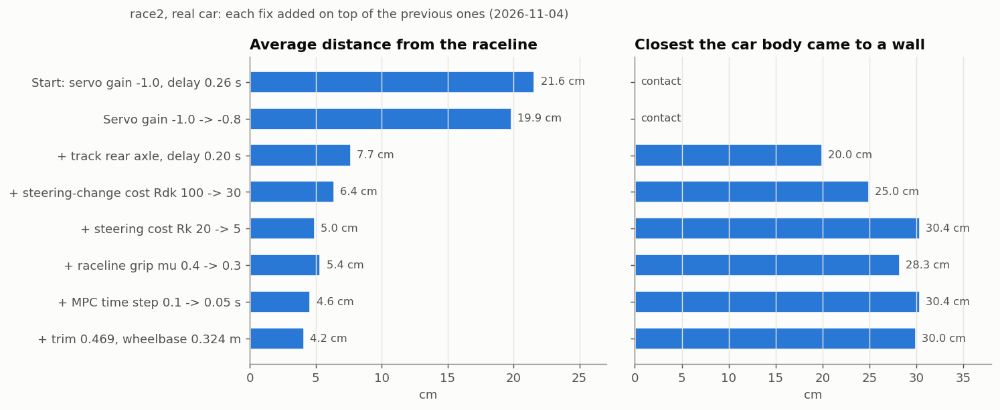
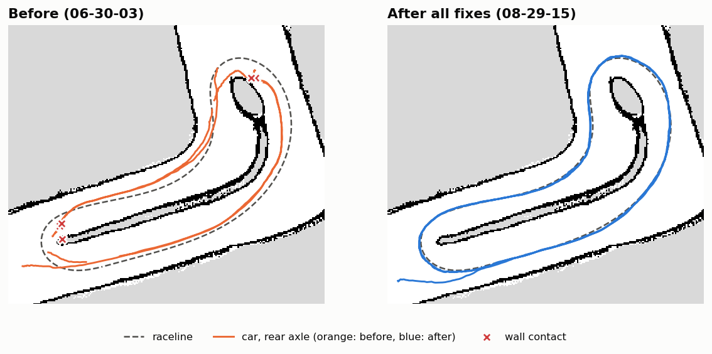
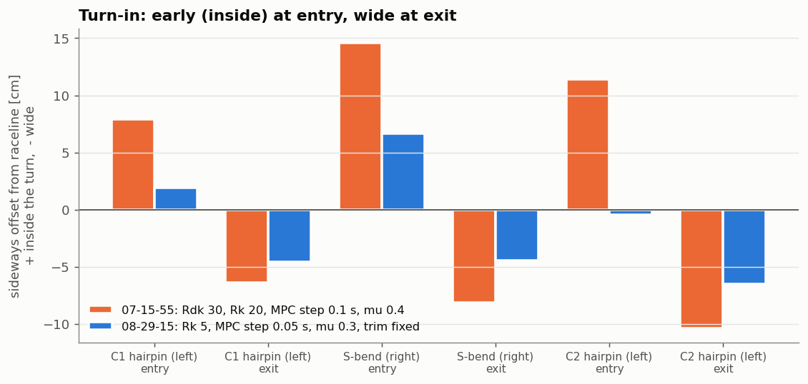
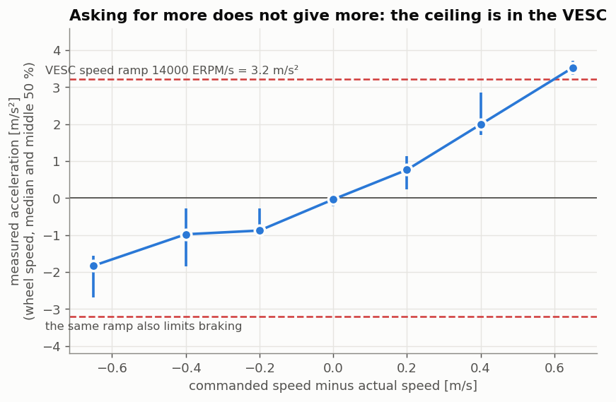
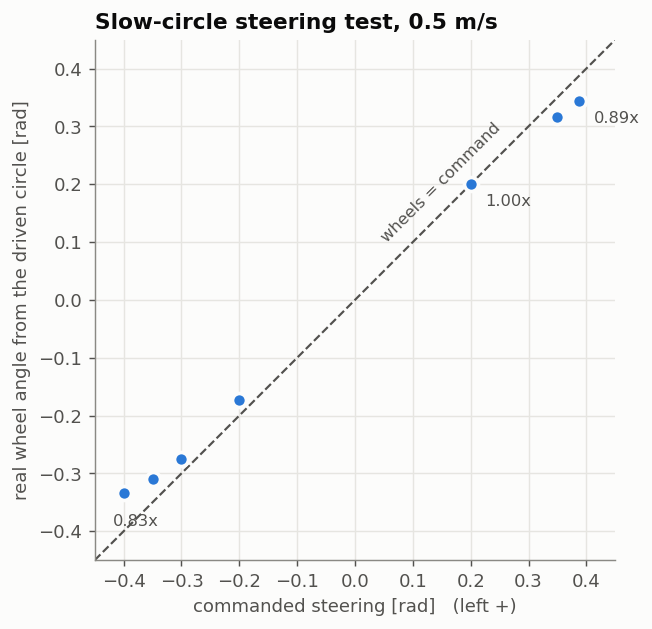
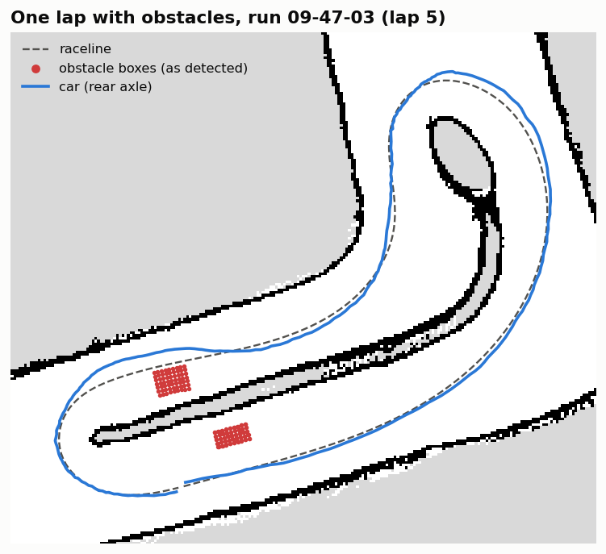
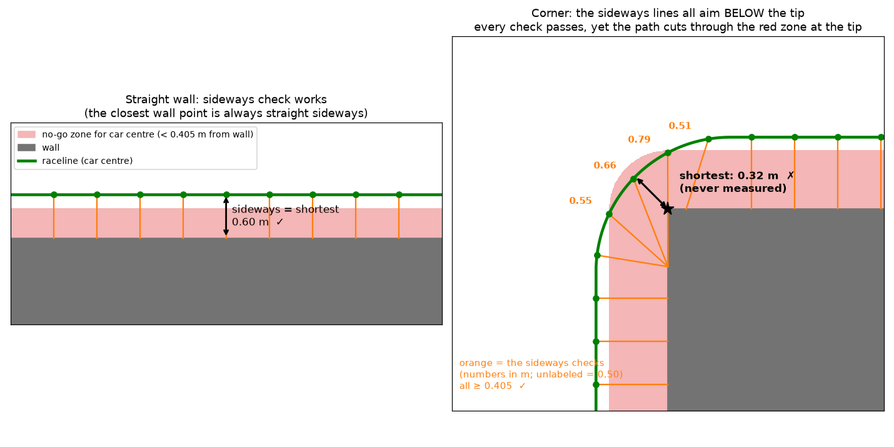

# MPC Tuning Log: Levine (sim) and race1 / race2 (real car)

Milestone changes to the Lab 7 MPC, the real car it runs on, and the obstacle avoidance built on top of it.
Only add an entry for a change that mattered (a new best lap, or a fix that made the next step possible), not for every run.

**Race result (2026-11-04, race2 with obstacles moved every lap): 4th of 14 teams on average lap time.** All of the race code (MPC, obstacle detection and planning, raceline, test and analysis tools) was implemented by the author of this log; the initial setup of the replacement VESC (V0) was done by teammates.

**Current best clean lap (sim): 8.31 s** ([M14](#m14--speed-command-delivers-the-planned-acceleration), run [2026-11-01_16-41-55](mpc/data/2026-11-01_16-41-55/summary.txt)). The current files are **no longer** this setup: since [R1](#r1--mpc-runs-on-the-real-car) they are set up for the real car. M14's node is saved as [mpc_node_ran.py](mpc/data/2026-11-01_16-41-55/mpc_node_ran.py) in that run's folder.

**Real car:** start with the [project summary](#project-summary-real-car-2026-11-02--11-04). Tracking: [R3–R10](#real-car-newest-first). Obstacles: [O1–O8](#obstacle-avoidance-on-the-real-car-newest-first). Measured car limits: [C1–C4](#car-limits-measured-newest-first).

**VESC (motor controller):** replaced on 2026-11-03 and retuned. R1 and R2 ran on the old VESC. See [VESC swap](#vesc-swap-and-speed-controller-tuning-newest-first) and [hardware](#hardware-and-platform-newest-first).

**The race code now lives in a copy:** `../jacob_opt_obstacles_restart` (built; this folder has `COLCON_IGNORE`). It adds the stop-and-rescan feature ([O7](#o7--stop-and-rescan-the-car-could-stop-forever)) and race settings; everything else matches this folder. Runs before 2026-11-04 13:00 were recorded here.

## Project summary (real car, 2026-11-02 → 11-04)

Three days on the real car, from a new VESC that had to be brought up to a 4th place in the obstacle race.

| | Start of race2 tracking work (run [06-30-03](mpc/data/2026-11-04_06-30-03/summary.txt)) | After the tracking fixes (run [08-29-15](mpc/data/2026-11-04_08-29-15/summary.txt)) |
|---|---|---|
| Average distance from the raceline | 21.6 cm | **4.2 cm** |
| Largest distance | 53.6 cm | **12.8 cm** |
| Closest the car body came to a wall | contact (3 wall hits) | **30 cm** |
| Laps without a takeover | 0 | 2 of 2 (14.61 and 14.69 s) |

With obstacles: best run [09-47-03](mpc/data/2026-11-04_09-47-03/summary.txt) drove **11 laps without a takeover, 10 of them at 11.85–12.1 s**; fastest obstacle lap 10.96 s ([11-19-36](mpc/data/2026-11-04_11-19-36/summary.txt)).
All tracking numbers in this log come from [tools/make_log_figures.py](mpc/tools/make_log_figures.py) with one rule: rear axle against the raceline, only while the MPC drives above 1 m/s after it has joined the line.





**What went wrong, and how each problem was found** (details in the linked entries):

1. **The VESC died** (no USB device on any port, cable or computer), so it was replaced ([H1](#h1--vesc-stops-showing-up-on-usb)). The new one drove the car **backwards** under the MPC; two quick fixes had hidden a reversed motor direction, so it was fixed once at the source ([H2](#h2--the-car-crept-backwards-under-the-mpc)).
2. **The particle filter wasted 5 of 6 CPU cores** on idle math-library threads. One environment variable raised its update rate from 16.7 to 27.7 Hz and halved the MPC's solve time ([H3](#h3--openblas-threads-ate-the-cpu)).
3. **Obstacle detection published nothing on the car.** Replaying the recorded data offline showed the coordinate transforms were being starved; a one-line fix took it from 0 to 14.6 detections per second ([O1](#o1--detection-published-nothing-on-the-car)). Later: boxes that only ever grew ([O2](#o2--obstacle-boxes-grew-without-limit)), walls seen as obstacles because the map is off by 0.2 m ([O3](#o3--phantom-obstacles-the-map-is-up-to-02-m-off)), and a car that could stop forever ([O7](#o7--stop-and-rescan-the-car-could-stop-forever)).
4. **The car cut inside every corner and hit walls.** Measured and fixed one cause at a time ([R3–R9](#real-car-newest-first)):
   - the new VESC's steering calibration made the wheels turn 25 % further than commanded (R3);
   - the MPC tracked the LiDAR as if it were the rear axle, 0.27 m too far forward (R4) — found by measuring how the pose point drifts into turns, and confirmed in a closed-loop simulation that runs the real MPC code;
   - the delay compensation was 0.26 s, the car's delay is now 0.20 s (R4);
   - MPC weights and a too-coarse 0.1 s prediction step made it steer early (R5, R6, R8);
   - steering trim and the wheelbase used by odometry (R9).
5. **Measured the car's real limits** instead of guessing ([C1–C4](#car-limits-measured-newest-first)): grip μ ≈ 0.40, steering gives about 0.89× the command, top speed at least 5.15 m/s, and an acceleration ceiling of 3.2 m/s² set by the VESC, not the motor.

One hypothesis was wrong and is kept here on purpose: after R7 the data suggested the steering topped out at 0.32 rad. A dedicated slow-circle test ([C1](#c1--slow-circle-steering-test)) showed the wheels reach about 0.34 rad; the shortfall at race speed was the tires (grip, [C2](#c2--grip-friction-coefficient)).

**Tools built for this** (all in `mpc/tools/` unless noted):
- `run_recorder.py` + `run_analysis.py`: every run saved with its exact settings, a summary, lap and segment timing, and (since O-entries) obstacle boxes, detour plans and the MPC's predicted path.
- `replay_detection.py`: reruns obstacle detection offline on a recorded bag.
- A closed-loop simulation that drives the real `mpc_node.py` code against a model of this car (delay, steering, LiDAR offset), on an isolated ROS domain. It was a scratch script and wasn't kept.
- `steering_test.py`: slow-circle steering test, stand test, straight-line acceleration test; `~/vesc_tests/`: scripted VESC speed test, max-speed test; `estimate_kp.py`.
- `make_log_figures.py`: regenerates every figure and number in this summary from the recorded runs.

**Final race configuration** (in `jacob_opt_obstacles_restart`): raceline mu 0.35, a_x 4 / a_brake 3 m/s², v_max 3.3 m/s, wall margin 0.4 m (predicted lap 9.66 s); MPC kinematic, time step 0.05 s × 16, Rk [0.01, 5], Rdk [0.01, 30], `MAX_SPEED` 3.3, `MAX_ACCEL` 3.3, `MAX_STEER` 0.38, `delay_comp` 0.20 s, `pose_offset` 0.27 m; VESC steering gain −0.8, offset 0.469.

## Summary (newest first)

| # | Levine lap (s) | What changed |
|---|---|---|
| [M14](#m14--speed-command-delivers-the-planned-acceleration) | **8.31** | Speed command fixed so the sim gets the acceleration and braking the MPC plans: `v + a/kp` (the right step for the sim's speed controller), plus the speed lost while the MPC solves. The v_max 14 line now reaches 13.1 m/s. New best by 0.93 s, only 0.15 s off the line's ideal lap. |
| [M13](#m13--more-grip-mu-09-then-v_max-14) | **9.24** | Raceline grip mu 0.75 → 0.9 (a_y 7.4 → 8.8): faster corners, 0 hits, new best by 0.54 s. Then v_max 10 → 14 (raceline and MPC): no gain (9.26 s), because the car only accelerates at about 3.8 m/s² on the straights. |
| [M12](#m12--weight-transfer-in-the-slip-mpc) | **9.78** | Weight transfer added to the slip MPC: braking now loads the front tires. Tracking error dropped by about 40%, and the car stays about 0.15 m further from the walls. Braking 9 and v_max 10 now run clean. New best by 0.40 s. |
| [M11](#m11--wall-clearance-measured-on-the-sim-map) | 10.30 | Raceline wall clearance is now measured on the sim map in every direction, not just sideways from the centerline. The closest the line gets to a wall (inside of C3) went from 0.29 to 0.40 m. 0.12 s slower than M10, but with more room. |
| [M10](#m10--raceline-braking-9-to-6) | **10.18** | Raceline braking 9 → 6 (acceleration stays 9). Same path as M9's a 9 line. The C3 inside hits are gone. New best. |
| [M9](#m9--slip-dynamics-in-the-mpc-st-model-no-weight-transfer) | **10.42** | MPC prediction model changed from kinematic to the sim's single-track slip model, with no weight transfer. The mu 0.75 line that hit walls 9 times in M8 now runs clean. Raising acceleration to 9 caused inside hits at C3. |
| [M8](#m8--raceline-a_x-6-v_max-8-limit-of-the-no-slip-mpc) | **11.79** | M7's raceline regenerated with a_x 6 and v_max 8 (grip still a_y 4.9). Raising grip to a_y 7.3 caused 9 wall hits. This is the baseline before adding slip to the MPC. |
| [M7](#m7--min-curvature-raceline-with-no-slip-limits) | — (no full lap yet, 0 hits) | Raceline regenerated with lower grip (a_y 4.9) so the kinematic MPC can hold it. Its ideal lap is 13.66 s, so as set up now it can't beat M5. |
| [M6](#m6--min-curvature-raceline-at-sim-limits) | 12.04 ✗ (23 hits) | First min-curvature raceline, made with the sim's friction limit. Fast but slid into walls at every corner. |
| [M5](#m5--mpc-max_speed-4--10-ms) | **13.58** | MPC `MAX_SPEED` 4 → 10 m/s, so the car can use the 10 m/s waypoint speeds. |
| [M4](#m4--mpc-max_accel-3--6-ms²-matched-to-waypoints) | 17.53 | MPC `MAX_ACCEL` 3 → 6 and waypoint a_accel/a_brake 6. First time a higher acceleration worked. |
| [M3](#m3--reference-points-spaced-at-reachable-speed) | — (no full lap recorded) | Reference trajectory spaced at a speed the car can reach. Fixed swerving on straights and made M4 possible. |
| [M2](#m2--steering-weight-r-100--20) | 18.46 | Steering weight R 100 → 20. First clean laps; tracking error halved. |
| [M1](#m1--baseline-with-run-recorder) | 18.76 ✗ (3 hits) | Baseline once the run recorder existed. |
| [M0](#m0--mpc-steers-at-all) | — | Solver warm start turned off; before this, steering was stuck at 0. |

**How lap times are measured:** best *clean* lap (no wall contact) in the run's `summary.txt`, on `levine_blocked`, timed by `tools/run_recorder.py`.
✗ means no lap was clean; the number shown is the best lap that touched a wall.
Laps are timed in wall-clock time, so a lagging sim (realtime factor below 1) makes them slower.

**Tip:** run notes can be wrong. The true settings are in each run's `meta.json`:
`mpc.mpc_config` has the MPC parameters, and `waypoints.md5` changes only when the installed waypoint file changes.

---

## Real car (newest first)

The F1TENTH car (Jetson Orin Nano, SICK TiM571 LiDAR, VESC 6 MK6), localized by the particle filter. R1–R2: Levine, recorded with `levine_debug_launch.py`. R3 on: race2, recorded with `ros2 launch mpc race2_obstacles_launch.py avoidance:=false` (the recorder's `real` mode).
Lap times aren't comparable with the sim table above, or between tracks.
There is no collision flag on the car, so a lap counts as clean when the MPC drove all of it (no joystick takeover in `/ackermann_cmd`). Wall contact is estimated from the car body's distance to the walls on the particle-filter map.

| # | Result | What changed |
|---|---|---|
| [R10](#r10--more-speed-and-acceleration) | v_max 4: laps 10.8 s (was 14.6). Asking for 9 m/s² gave 3.4 and slid wide at the C2 exit. | Raceline v_max 2 → 4 and a_x 2 → 4 → 9; MPC `MAX_ACCEL` to match |
| [R9](#r9--steering-trim-and-the-measured-wheelbase) | **4.2 cm** average, 12.8 cm max, 30 cm from walls; early turn-in gone | Steering trim 0.460 → 0.469; wheelbase 0.324 m in the MPC and in `/odom` |
| [R8](#r8--mpc-time-step-01--005-s) | 4.6 cm; C2 entry 12 → 8 cm inside | MPC prediction step 0.1 → 0.05 s (16 steps, same 0.8 s horizon) |
| [R7](#r7--slower-corners-raceline-mu-04--03) | 5.4 cm; little net change | Raceline grip mu 0.4 → 0.3 |
| [R6](#r6--steering-cost-rk-20--5) | 5.0 cm, 3 clean laps (14.14–14.17 s) | Steering-size cost Rk 20 → 5 |
| [R5](#r5--steering-change-cost-rdk-100--30) | 6.4 cm, 25 cm from walls | Steering-change cost Rdk 100 → 30 |
| [R4](#r4--track-the-rear-axle-not-the-lidar-delay-020-s) | 21.6 → **7.7 cm**, no wall contact | MPC tracks the rear axle (`pose_offset` 0.27 m), delay compensation 0.26 → 0.20 s |
| [R3](#r3--steering-calibration-after-the-vesc-swap) | wall hits 2 → 1 | VESC steering gain −1.0 → −0.8 |
| [R2](#r2--delay-compensation-stops-the-06-hz-steering-oscillation) | 0.6 Hz oscillation half of R1's best run | Delay compensation: each solve starts from where the car will be 0.26 s later, the measured delay from a steering command to the turn showing up in the pose. |
| [R1](#r1--mpc-runs-on-the-real-car) | first full lap (103.4 s incl. a long stop) | New MPC package ported to the car: particle-filter pose, kinematic model, 2 m/s limits, `v + a·DTK` speed command. The car oscillated at 0.6 Hz. |

### R10 — More speed and acceleration
2026-11-04 · runs [08-34-18](mpc/data/2026-11-04_08-34-18/summary.txt) (v_max 4), [08-38-50](mpc/data/2026-11-04_08-38-50/summary.txt) (+ accel 4), [08-45-12](mpc/data/2026-11-04_08-45-12/summary.txt) (accel 9, v_max 3)

| Symptom | Root cause | Fix / result |
|---|---|---|
| (Goal.) Laps of 14.6 s with the 2 m/s line. | Speed limit only. | Raceline v_max 2 → 4: **10.78 / 10.81 s**, clean, top speed 4.1 m/s (recorder's tracking error 10 cm average). a_x / a_brake 4: 10.39 s. |
| With a_x / a_brake 9 (raceline and MPC): five joystick takeovers, all at the **C2 hairpin exit**, with the car at the planned speed. | The raceline shares grip between turning and speeding up (friction ellipse), but with a_x 9 against a_y 2.94 it still plans 4–5 m/s² of speeding up while the car is turning hard out of C2. The tires can't do both, so the car slid wide. The car also can't deliver 9: the VESC caps it at about 3.2 m/s² ([C4](#c4--acceleration-ceiling)). | Back to limits the car can do. Race setting: a_x 4 / a_brake 3, v_max 3.3, mu 0.35, `MAX_ACCEL` 3.3. |

### R9 — Steering trim and the measured wheelbase
2026-11-04 · run [08-29-15](mpc/data/2026-11-04_08-29-15/summary.txt) · compared with [07-46-18](mpc/data/2026-11-04_07-46-18/summary.txt)

| Symptom | Root cause | Fix / result |
|---|---|---|
| The MPC needed −0.013 rad to drive straight, and the slow-circle test turned tighter left than right. | Steering trim: the wheels sat ~0.011 rad left of the command. | `steering_angle_to_servo_offset` 0.460 → **0.469**. Straight-line command now +0.005 rad. |
| `/odom` overstated turning by 30 %. | `vesc.yaml` `wheelbase` was the stock 0.25 m; the measured wheelbase is 0.324 m. `/odom` feeds the particle filter's motion model between scans. | `wheelbase` 0.324 in `vesc.yaml`, `WB` 0.33 → 0.324 in the MPC (and raceline, planner, tests). |
| The trim edit had no effect on the first try. | The installed `vesc.yaml` was a stale **copy**, not a link to the source file. | `colcon build --symlink-install --packages-select f1tenth_stack`. |
| Result | — | Average **4.2 cm**, max 12.8 cm, 30 cm from walls, 0 pose jumps, 2 clean laps (14.61, 14.69 s). Hairpin entries now +1.9 and −0.5 cm (were +5 and +8); the remaining error is 5–7 cm wide in the hairpins (tires, [C2](#c2--grip-friction-coefficient)). |



### R8 — MPC time step 0.1 → 0.05 s
2026-11-04 · run [07-46-18](mpc/data/2026-11-04_07-46-18/summary.txt)

| Symptom | Root cause | Fix / result |
|---|---|---|
| The car still entered every turn 5–15 cm inside. A simulated *perfect* car (no delay, exact model) did it too, so it came from the MPC itself. | The prediction model moves the car 0.2 m along its old heading in each 0.1 s step (forward Euler). It thinks the car turns later than it does, so it starts steering early. | `DTK` 0.1 → 0.05, `TK` 8 → 16 (same 0.8 s look-ahead). The speed command keeps `a × 0.1` so speeding up and braking don't change. In the sim: error −30 %. On the car: 5.4 → **4.6 cm**, C2 entry 12 → 8 cm inside, closest wall 28 → 30 cm. Solve p95 16 ms (commands every 40 ms). |

### R7 — Slower corners: raceline mu 0.4 → 0.3
2026-11-04 · run [07-34-49](mpc/data/2026-11-04_07-34-49/summary.txt)

| Symptom | Root cause | Fix / result |
|---|---|---|
| Wide at every turn exit (9–18 cm in C2). Above ~2 m/s² of cornering the car turned only 0.87–0.89× the command. | Tires losing grip at hairpin speed (3.7–4.6 m/s² of cornering). | Raceline mu 0.4 → 0.3 (hairpins 1.85 → 1.60 m/s). C2 exit 9 → 5 cm wide, but entry 10 → 12 cm and overall 5.0 → 5.4 cm: little net change, 0.3 s slower laps. The rest of the shortfall was steering ([C1](#c1--slow-circle-steering-test)). |

### R6 — Steering cost Rk 20 → 5
2026-11-04 · run [07-26-25](mpc/data/2026-11-04_07-26-25/summary.txt)

| Symptom | Root cause | Fix / result |
|---|---|---|
| Early turn-in, worst into the right-hand S-bend (15 cm inside). | A high cost on steering *size* makes the MPC spread each turn out, starting it early. | Rk [0.01, 20] → [0.01, **5**]. 6.4 → **5.0 cm**, S-bend entry 15 → 6 cm, closest wall 25 → 30 cm, 3 clean laps 14.14–14.17 s (std 0.01 s). Steering oscillation unchanged (0.048 rad). |

### R5 — Steering-change cost Rdk 100 → 30
2026-11-04 · run [07-15-55](mpc/data/2026-11-04_07-15-55/summary.txt)

| Symptom | Root cause | Fix / result |
|---|---|---|
| Early at entries, wide at exits, worst where the steering swings quickly (S-bend). | A high cost on steering *changes* makes the MPC start each change early and finish it late. | Rdk [0.01, 100] → [0.01, **30**] (sim: S-bend max 18 → 13 cm). On the car: 7.7 → 6.4 cm, closest wall 20 → 25 cm, oscillation 0.043 → 0.046 rad (no extra wobble). |

### R4 — Track the rear axle, not the LiDAR; delay 0.20 s
2026-11-04 · run [07-01-18](mpc/data/2026-11-04_07-01-18/summary.txt) · compared with [06-46-16](mpc/data/2026-11-04_06-46-16/summary.txt)

| Symptom | Root cause | Fix / result |
|---|---|---|
| With the steering calibrated (R3), the car still cut inside every turn, in both directions, by up to 0.5 m and clipped the inner island. | **The MPC tracked the LiDAR as if it were the rear axle.** The particle-filter pose is the LiDAR, 0.27 m ahead of the rear axle; the kinematic model (and the simulator it was tuned in) uses the rear axle. A point that far forward swings into the turn as soon as the wheels steer. Measured: the pose point travels 15–20° off the car's heading in the hairpins, exactly what a point 0.27 m ahead does. | New parameter `pose_offset`: the MPC moves the pose back to the rear axle before solving (0 by default, 0.27 in the race launch). |
| — | Delay compensation 0.26 s was measured on the old VESC; the summary now measures 0.20–0.24 s. | `delay_comp` 0.26 → 0.20 (launch default). |
| Result | Confirmed first in a closed-loop sim running the real `mpc_node.py` against a car with this delay, steering and LiDAR position: it reproduced the real run (0.50 m inside vs 0.49–0.51 m), and these two fixes brought it to 0.18 m with 0.25 m to the walls. | On the car: 19.9 → **7.7 cm** average, 46 → 22 cm max, **no wall contact** (20 cm closest). |

### R3 — Steering calibration after the VESC swap
2026-11-04 · run [06-46-16](mpc/data/2026-11-04_06-46-16/summary.txt) · compared with [06-30-03](mpc/data/2026-11-04_06-30-03/summary.txt)

| Symptom | Root cause | Fix / result |
|---|---|---|
| On race2 with no obstacles the car turned in early and hit walls several times. | The path curvature from the pose was **1.24×** what the command should give (same in three runs). The VESC swap had changed `steering_angle_to_servo_gain` from −0.8 to −1.0: 25 % more wheel angle for every command. | Gain back to **−0.8**: the car now turns 0.98× the model. Wall hits 2 → 1. Still inside every turn (R4). |
| Left steering was clipped at 0.31 rad. | With gain −1.0 and offset 0.46, `servo_min` 0.15 limited left steering to 0.31 rad; the hairpins need ~0.34. | Gain −0.8 raises the left limit to 0.39 rad. |

### R2 — Delay compensation stops the 0.6 Hz steering oscillation
2026-11-01 · run [21-10-27](mpc/data/2026-11-01_21-10-27/summary.txt) · compared with [20-46-31](mpc/data/2026-11-01_20-46-31/summary.txt) and [20-39-41](mpc/data/2026-11-01_20-39-41/summary.txt) (R1)

Same raceline (md5 d57ca616), weights and limits as R1. Only `delay_comp` changed (0 → 0.26 s).

| Symptom | Root cause | Fix / result |
|---|---|---|
| (From R1.) The car weaved left-right on the straights. Steering oscillated at **0.6 Hz** (one swing every ~1.65 s) in both R1 runs. | **Delay the MPC doesn't know about.** Fitting yaw rate = gain · v·tan(steer command(t − delay)) / WB to the particle-filter heading gives **0.26 s** in both R1 runs (R² 0.88 and 0.79). That is 2.6 MPC steps (DTK 0.1 s). The MPC solves from a pose that is already old, and its command acts late, so it keeps over-correcting. A 0.26 s delay adds about 60° of phase lag at 0.6 Hz, enough to turn a damped loop into an oscillating one. Not the cause: the car turns *less* than the model expects (gain 0.81–0.87), which damps, and the servo trim is only +0.018 rad (1°). | `delay_comp` (see the code below). Run 21-10-27: the 0.6 Hz part of the steering dropped to **0.014 rad** (0.026 in 20-46-31, 0.067 in 20-39-41). The strongest frequency moved from 0.61 to 0.33 Hz. The car visibly stopped weaving. |
| Where the 0.26 s comes from | The new `/tf` recording measured the particle filter at **57 ms** mean (p95 73 ms) from scan to pose. So about 0.2 s is the servo and car responding, and about 0.06 s is localization. The MPC's own solve (~25 ms) comes on top. | — (only the total matters for the fix) |
| 20-39-41 oscillated twice as much as 20-46-31, with the same settings. | Bad localization in 20-39-41: **251 pose jumps** (largest 1.25 m) vs 4. Each jump yanks the steering. Its solves were also slower (p95 52 vs 29 ms), which adds delay. | Set a good initial pose before each run. The summary now counts pose jumps. |

The fix: before solving, move the measured state forward by `delay_comp` seconds through the kinematic bicycle model. It replays the steering commands sent during the last `delay_comp` seconds in order, since those are the ones acting on the car until the new command lands. The MPC's starting state and the reference path are both built from that predicted state. Speed is held at the measured value.

```python
# odom_callback, before building the reference path (mpc_node.py predict_delay)
x, y, yaw = self.predict_delay(x, y, yaw, v, time.monotonic())
# after publishing /drive
self.cmd_hist.append((time.monotonic(), float(speed_output), float(steer_output)))
```

`delay_comp` is a ROS parameter (default 0 = off). `levine_debug_launch.py` sets `DELAY_COMP = '0.26'`; override one run with `delay_comp:=<s>`.

**Caveats, still to confirm with a full lap:**
- The MPC drove only **31 s / 59 m** of 21-10-27, with no complete lap. The joystick drove 70 s.
- Mean distance from the raceline while the MPC drove went **up**: 0.080 → 0.133 m (heading error 3.4 → 4.4°). The 0.89 m maximum was at 83 s, right before the joystick took over.
- Faster steering jitter (above 0.75 Hz) went up: 0.014 → 0.025 rad. So the summary's overall "oscillation" number barely moved (0.035 → 0.036 rad), even though the 0.6 Hz weave dropped by half.
- After the fix, the command-to-turn fit is weaker: delay 0.22 s, gain 0.72, R² 0.54, on less data.

| Parameter / code | R1 (20-39-41, 20-46-31) | R2 (21-10-27) |
|---|---|---|
| `delay_comp` | — (didn't exist) | 0.26 s |
| `mpc_node.py` md5 | 97ecaf04 | cbd1b6e3 |
| Waypoints / `MAX_SPEED` / `MAX_ACCEL` / Rk / Rdk | d57ca616 / 2.0 / 3.0 / [0.01, 20] / [0.01, 100] | same |

### R1 — MPC runs on the real car
2026-11-01 · runs [20-39-41](mpc/data/2026-11-01_20-39-41/summary.txt), [20-46-31](mpc/data/2026-11-01_20-46-31/summary.txt) · first full lap: 103.4 s (includes a long stop: C3 lost 59.7 s)

Raceline `levine_real_mincurv.csv` from `min_curv_raceline` with `params_real.yaml`: mu 0.6, a_x/a_brake 3, v_max 2.0, so 2.0 m/s everywhere. Ideal lap 30.96 s.

| Symptom | Root cause | Fix |
|---|---|---|
| `ros2 launch` failed: `executable 'mpc_node.py' not found`. | Moving the package dropped the executable bit (the old package's node had it). | `chmod +x scripts/mpc_node.py` |
| Sim-only inputs | The car has no `/ego_racecar/odom`. The particle filter's `/pf/pose/odom` only fills forward speed (copied from the VESC), so sideways speed and yaw rate are 0, and the slip model's parameters are the sim's. | Pose topic `pf/pose/odom`; `model` kinematic. |
| The speed command was tuned to the sim | M14's `v + lag·a + a/kp` uses the sim's speed-controller gains, but the VESC runs its own speed control. | Back to `v + a·DTK` (M14's lines are commented out). `MAX_SPEED` 14 → 2.0, `MAX_ACCEL` 9 → 3.0. |
| The car oscillated at 0.6 Hz | See R2. | R2 |

Recorder (`tools/run_recorder.py --platform real`, the default) records `/pf/pose/odom`, `/drive`, `/ackermann_cmd` (the mux's real output topic: bringup's remap to `/ackermann_drive` doesn't match), `/odom`, `/sensors/core`, `/tf` and the `/mpc/*` topics. Laps are timed from raceline crossings.

---

## VESC swap and speed-controller tuning (newest first)

The VESC was replaced with a new unit of the same model (VESC 6 MK6, shows as `60_MK6`) and retuned. After that, manual driving was poor: stutter at low speed (worst when accelerating from rest), weak braking and a low top speed.
This section isn't MPC tuning, but it changes how the car responds to every speed command, so MPC runs before and after 2026-11-03 aren't directly comparable.

**Who controls what.** The Jetson only sends a target speed in ERPM (`/commands/motor/speed` = `speed_to_erpm_gain` × m/s). The VESC decides how to reach it: speed PID, ramp, current limits, motor model and sensorless startup. Of the three symptoms, only the top speed was set on the Jetson (joystick `scale`). Stutter and braking were VESC settings.

**Test method.** A scripted test sends the same speed profile every time, so each change can be compared with the last one:
`~/vesc_tests/run_speed_test.sh ground` (or `stand` with the wheels off the ground) runs `~/vesc_tests/speed_test.py` and records a bag to `~/vesc_tests/<mode>_<date-time>/`.
Steps: crawls at 0.3, 0.5 and 0.8 m/s (3 s each, twice), a 0 → 1.5 m/s ramp over 4 s, and three hard 0 → 2.0 m/s launches held 2 s and then stopped. Every step ends with 2 s at 0 m/s. The car only moves while RB (button 7) is held. It publishes on `/drive`, so holding the human deadman (LB) overrides it. Run bringup first (`sick_bringup_launch.py`).
"Speed" below is VESC ERPM ÷ 4363.1 (wheel speed, not ground speed). "Braking" is the 90% → 10% speed drop after a hard stop.

| # | Result | What changed |
|---|---|---|
| [V4](#v4--openloop-erpm-1200--800-launch-stall-fixed) | **3/3 hard launches smooth**, peak 2.16–2.18 m/s, braking 3.7–3.9 m/s². 0.3 m/s still stutters. | FOC openloop ERPM 1200 → 800 |
| [V3](#v3--speed-ramp-25000--14000-erpms) | 2/3 launches smooth, overshoot cut to 2.1–2.2 m/s on those, braking consistent at 3.7–3.9 m/s² | Speed PID ramp 25000 → 14000 ERPM/s |
| [V2](#v2--motor-detection-on-the-new-vesc) | No clear change | FOC motor detection run on the new VESC (inductance was 3× off) |
| [V1](#v1--speed-pid-ki-and-kd-fixed) | Holds 2.00 m/s on the stand, braking 1.5 → 3.3–6.8 m/s². New: overshoot to 2.2–2.7 m/s. | Speed PID Ki 0.00003 → 0.004, Kd 0.0008 → 0.0001 |
| [V0](#v0--baseline-after-the-swap) | Stutter below ~0.5 m/s, braking ~1.5 m/s², top speed 1.84 m/s | Baseline: new VESC loaded with the `vesc6_upenn_foc.xml` template |

### V4 — Openloop ERPM 1200 → 800: launch stall fixed
2026-11-04 · run `~/vesc_tests/ground_20261104-001429` · compared with V3

| Symptom | Root cause | Fix / result |
|---|---|---|
| (From V3.) Some hard launches stalled at **~0.25 m/s for 0.4–0.8 s at the 60 A limit**, then took off and overshot to 2.5 m/s. It happened on some launches and not others, both before and after V2. | **Stuck in sensorless open-loop startup.** Below the openloop ERPM, the VESC can't estimate rotor position, so it spins the field blindly and switches to the observer once the motor is fast enough. 0.25 m/s ≈ 1100 ERPM, just under the 1200 switch point: the motor wasn't keeping up with the blind rotation, so the hand-over kept failing. It probably depends on where the rotor stops, which is why it was intermittent. | Openloop ERPM 1200 → 800, so the observer (now with correct motor values from V2) takes over sooner. **3/3 hard launches smooth**, peak current ~38 A (no time at 60 A), peak 2.16–2.18 m/s, settling to ~2.05. Braking 3.7–3.9 m/s², peak brake current ~21 A. |
| 0.3 m/s crawl still stutters | At a 0.3 m/s target the car shuffles between 0 and 0.15 m/s for ~1.5 s at 15–30 A, then gets going. That much current should move the car, so the position estimate near standstill is still wrong. A hard launch passes through this zone in a fraction of a second; a gentle one stays in it. This is a known limit of motors without hall sensors at very low speed. | Not fixed. See [Open issues](#open-issues-not-milestones). |

Not tried: "Start Current Decrease" (FOC → Sensorless, `foc_start_curr_dec`) 1.0 → 0.6. It would cap current at standstill at 36 A, rising to 60 A at `foc_start_curr_dec_rpm` (2500 ERPM ≈ 0.57 m/s). Launches now peak at ~38 A and the crawl uses 15–30 A, so it would change little. Keep it in mind if launch stalls come back.

| Parameter (VESC Tool) | V3 | V4 |
|---|---|---|
| FOC → Sensorless → Openloop ERPM (`foc_openloop_rpm`) | 1200 | 800 |

### V3 — Speed ramp 25000 → 14000 ERPM/s
2026-11-04 · run `~/vesc_tests/ground_20261104-000354` · compared with V2

| Symptom | Root cause | Fix / result |
|---|---|---|
| (From V1.) A 2.0 m/s step overshot to **2.2–2.75 m/s** and took over a second to come back. Only on the ground: on the stand it held 2.00. | **Integral windup.** The speed setpoint ramped at 25000 ERPM/s (5.7 m/s²), faster than the car can accelerate, so the PID sat at the 60 A limit while its integral kept growing. Rough check: 0.5 s at full error stores enough integral to hold ~0.2 m/s of overshoot for several seconds, which matches. On the stand the wheels reach speed almost instantly, so little integral builds up. | Ramp 25000 → 14000 ERPM/s (≈ 3.2 m/s², about what the car can do). 2 of 3 hard launches stayed off the current limit (peak ~40 A) and peaked at 2.16–2.19 m/s. |
| Braking varied a lot (3.1–6.3 m/s²) | The ramp also limits how fast the setpoint falls. | Braking now **3.7–3.9 m/s² every time** (peak brake current ~21 A). The ramp caps braking at about 3.2 m/s² of setpoint change; the measured 90 → 10% rate comes out a bit higher. |
| One launch still stalled at ~0.25 m/s at 60 A for 0.4 s, then overshot to 2.5 m/s | Open-loop startup, see V4. | V4 |

**MPC note:** the VESC now changes speed at no more than ~3.2 m/s², up or down. The real-car MPC uses `MAX_ACCEL` 3.0, which fits under it. Raising `MAX_ACCEL` above ~3.2 on the car would need a faster VESC ramp too.

| Parameter (VESC Tool) | V2 | V3 |
|---|---|---|
| PID Controllers → Speed → Ramp eRPMs/s (`s_pid_ramp_erpms_s`) | 25000 | 14000 |

### V2 — Motor detection on the new VESC
2026-11-03 · runs `~/vesc_tests/ground_20261103-234854`, `~/vesc_tests/ground_20261103-235230` · compared with V1's ground run

| Symptom | Root cause | Fix / result |
|---|---|---|
| (From V1.) Stutter below ~0.5 m/s even with the wheels in the air. | Suspected: the VESC was loaded with the shared `vesc6_upenn_foc.xml` template, so its motor model (resistance, inductance, flux linkage) may not have been measured on this motor. The sensorless observer depends on those values most at low speed. | FOC → General → Detect and Calculate Parameters: RL, λ, Apply (wheels off the ground), then write the motor config. **Inductance was 3× off** (0.86 → 2.55 µH). |
| Did it help? | No clear change: the 0.3 m/s crawl was just as rough, some launches still stalled at ~0.25 m/s at 60 A, and overshoot was the same (2.2–2.75 m/s). | Kept, because these are the measured values for this motor. The remaining problems were the ramp (V3) and open-loop startup (V4). |

Writing the config shows a VESC Tool warning, "Slow ABS Current Limit is set". It comes from the template (`l_slow_abs_current` 1), not from detection, and was on for all runs here. VESC Tool also showed "limited mode" (VESC Tool and firmware versions don't fully match), so after each write, reconnect and read the config back to confirm it saved.

| Parameter (VESC Tool, FOC → General) | Template (V0–V1) | Measured (V2) |
|---|---|---|
| Motor resistance R | 5.9 mΩ | 6.13 mΩ |
| Motor inductance L | 0.86 µH | 2.55 µH |
| Lq − Ld | 0.24 µH | 0.32 µH |
| Flux linkage λ | 0.776 mWb | 0.732 mWb |
| Current KP / KI | 0.0009 / 5.92 | 0.0051 / 12.26 |
| Observer gain (×1M) | 1660 | 1866 |

### V1 — Speed PID Ki and Kd fixed
2026-11-03 · runs `~/vesc_tests/stand_20261103-231214` (wheels off the ground) and `~/vesc_tests/ground_20261103-232602` · compared with V0's kp test

| Symptom | Root cause | Fix / result |
|---|---|---|
| (From V0.) Full stick only reached 1.84 m/s for a 2.0 m/s command. | Speed PID Ki was 0.00003, about 130× below the VESC default (0.004), so the steady-state error never closed. | Ki → 0.004. Stand: holds **2.00 m/s**. |
| (From V0.) 10–60 A current spikes at low speed | Kd was 0.0008, 8× the default (0.0001). The speed estimate is noisy at low speed, and D turns that noise into current spikes. | Kd → 0.0001. Stand: 0.5, 0.8 and 2.0 m/s within ~1%, wobble ±0.01 m/s. |
| (From V0.) Weak braking, ~1.5 m/s² | The low-gain PID barely braked (≤17 A of the 60 A allowed) and the car mostly coasted. The current limits weren't the cause: motor −60 A, battery regen −20 A. | Ground: **3.3–6.8 m/s²**. |
| 0.3 m/s still stutters, **even on the stand**: drops to 0 several times with ~20 A spikes. Once the wheel spun up to ~1 m/s right after the command went to 0. | Not a tuning problem under load: the sensorless position estimate fails near standstill. | V2, V4 (still open) |
| New on the ground: overshoot to 2.2–2.7 m/s, launches stuck at 60 A, and one ~0.3 m/s backward roll after a hard stop | The higher Ki winds up while the motor sits at the current limit. | V3 |

| Parameter (VESC Tool, PID Controllers → Speed) | V0 | V1 |
|---|---|---|
| Ki (`s_pid_ki`) | 0.00003 | 0.004 |
| Kd (`s_pid_kd`) | 0.0008 | 0.0001 |
| Kp (`s_pid_kp`) | 0.004 | 0.004 (unchanged) |

### V0 — Baseline after the swap
2026-11-03 · kp test bag `~/kp_test/kp_test_0.mcap` (21:45, joystick steps to 0.45 and 2.0 m/s) and fit `~/kp_test/kp_fit.png` (up kp 2.07, down kp 4.64, decel capped at 1.5 m/s², delay 0.03 s)

New VESC loaded with `vesc6_upenn_foc.xml`: sensorless FOC (motor has no hall sensors; λ matches a 3500 kV 4-pole motor), motor current ±60 A, battery +60/−20 A, max ERPM 30000, speed PID Kp 0.004 / Ki 0.00003 / Kd 0.0008, ramp 25000 ERPM/s, min ERPM 500, openloop ERPM 1200, `m_invert_direction` 1.
Jetson `f1tenth_stack/config/vesc.yaml` (edited 2026-11-03 20:54): `speed_to_erpm_gain` 4614 → −4363.1 (sign flip plus a new scale), `steering_angle_to_servo_gain` −1.0, offset 0.460, `speed_min/max` ±25000. Joystick `scale` 2.0 m/s (cut from 5.0 on 2026-09-20).

| Symptom | Root cause | Result |
|---|---|---|
| Stutter at low speed: at a 0.45 m/s command, speed swung between 0 and 0.4 m/s with 10–60 A spikes | Speed PID gains (V1) plus sensorless low-speed tracking (V2, V4) | — |
| Stutter launching from rest: speed dropped from ~2800 to 500 ERPM while at 60 A forward | The motor lost sync: the VESC's rotor-position estimate failed | — |
| Weak braking: ~1.5 m/s², nearly straight-line slowdown, ≤17 A of brake current | Speed PID barely braking (V1) | — |
| Low top speed: 1.84 m/s at full stick | Jetson joystick `scale` 2.0 caps the command at 2.0 m/s; the PID's steady-state error (V1) took off the rest. The motor was only at ~12% duty, so there is plenty of headroom. | Still capped at 2.0 m/s, see Open issues. |

---

## Hardware and platform (newest first)

| # | Result | What changed |
|---|---|---|
| [H3](#h3--openblas-threads-ate-the-cpu) | Particle filter 16.7 → 27.7 Hz, MPC solve 22.8 → 12.3 ms | `OPENBLAS_NUM_THREADS=1` in the filter and MPC launch files |
| [H2](#h2--the-car-crept-backwards-under-the-mpc) | Car drives forward under the MPC again | Motor direction fixed once, in `speed_to_erpm_gain`; two compensating edits removed |
| [H1](#h1--vesc-stops-showing-up-on-usb) | Faulty VESC found and replaced | Systematic elimination of port, cable, computer and software |

### H3 — OpenBLAS threads ate the CPU
2026-11-03 · measured live on the car (see `HANDOFF_OBSTACLES.md` §2)

| Symptom | Root cause | Fix / result |
|---|---|---|
| The particle filter used 566 % CPU and ran at 16.7 Hz; the MPC solved in 22.8 ms and sent ~20 commands/s. | pip numpy's OpenBLAS kept 5 idle worker threads spinning at 100 % each. | `OPENBLAS_NUM_THREADS=1` (same math, one thread). Filter 100 % CPU at **27.7 Hz** (jitter 17 → 0.5 ms); Jetson 24 % busy; MPC solve **12.3 ms**, callback 31.6 → 16.3 ms, ~38 commands/s. |

### H2 — The car crept backwards under the MPC
2026-11-03 evening · first race2 run [21-01-33](mpc/data/2026-11-03_21-01-33/summary.txt) after the fix

| Symptom | Root cause | Fix / result |
|---|---|---|
| The same MPC that worked before the swap made the car creep slowly backwards. Joystick driving looked fine. | The new VESC spins the motor backwards for a positive command. During the retune this had been hidden in two places instead of fixed: the joystick scale was set to −1, and a minus sign was added to the speed in `vesc_to_odom.cpp`. The MPC sends a normal positive speed, so the car went backwards while `/odom` said forwards. Found by echoing every stage (`/drive` → `/ackermann_cmd` → `/commands/motor/speed` → `/sensors/core` → `/odom`) with the car on a stand: each `/odom` value was the VESC reading with the sign flipped. | One fix at the source: `speed_to_erpm_gain` −4363.1 (flips both the motor command and odometry); joystick scale and odometry code back to normal. |

### H1 — VESC stops showing up on USB
2026-11-03 morning

| Symptom | Root cause | Fix / result |
|---|---|---|
| Joystick did nothing; the VESC driver exited with "failed to open the serial port". | The VESC itself: powered (LED on) but never enumerated. Ruled out one at a time: replug, a second Jetson port, a new cable, a keyboard on the same port (worked), a Windows laptop (nothing in Device Manager) and VESC Tool AutoConnect (no connection). | Replaced with a new unit of the same model. Its setup and tuning: [VESC swap](#vesc-swap-and-speed-controller-tuning-newest-first). |

---

## Car limits, measured (newest first)

| # | Result | How |
|---|---|---|
| [C4](#c4--acceleration-ceiling) | **3.2 m/s²** both ways, set by the VESC's speed ramp; the motor isn't the limit | Speed error vs measured acceleration from race runs |
| [C3](#c3--top-speed) | **≥ 5.15 m/s** (the hallway ran out first) | `~/vesc_tests/` max-speed test |
| [C2](#c2--grip-friction-coefficient) | **μ ≈ 0.40** (95 % interval 0.36–0.54) | Lateral acceleration vs steering demand, 20 runs |
| [C1](#c1--slow-circle-steering-test) | Wheels give **0.83–1.00× the command** (median 0.89); about 0.34 rad at full lock | Slow circles at 0.5 m/s, `tools/steering_test.py circle` |

### C4 — Acceleration ceiling
2026-11-04 · run [08-45-12](mpc/data/2026-11-04_08-45-12/summary.txt) (`MAX_ACCEL` 9)



| Finding | Evidence | Consequence |
|---|---|---|
| Speeding up tops out at ~3.4 m/s² (wheel speed) however hard the MPC asks. | Commands 0.5–0.8 m/s above the actual speed all give 3.5 m/s². The VESC speed PID ramp is 14000 ERPM/s = **3.2 m/s²** (set in [V3](#v3--speed-ramp-25000--14000-erpms) to stop overshoot). Motor current at the ceiling: 30–40 A of the 60 A limit. | The ramp, not the motor, is the limit. Raising it (VESC Tool, in steps, watching overshoot) is the way to more acceleration. |
| Braking is weaker: typically 1–2 m/s², ~3 at best. | The same ramp caps it, and braking never used more than ~17 A of motor current or −2.4 A back into the battery. | Check VESC Tool "Motor Current Min" and "Battery Current Min". |
| The node asks for too little. | `speed = v + a × 0.1` gets about half to 60 % of a moderate planned acceleration; the VESC's response is roughly `a ≈ kp × (command − v)` with kp ≈ 4–6. | `v + a × 0.2` would match (not applied yet). |
| `vesc.yaml` `max_acceleration: 4.0` does nothing. | It belongs to the `throttle_interpolator` node, which is commented out in both bringup files. `current_max`, `brake_min/max` only clip direct current/brake commands; the car is driven by speed commands. Only `speed_max` (25000 ERPM = 5.73 m/s) applies. | — |

A straight-line launch and stop test for this is ready: `tools/steering_test.py accel` (reports acceleration, braking, current, overshoot, and wheel spin or skid against the particle filter). Not run yet.

### C3 — Top speed
2026-11-04 · `~/vesc_tests/max_speed_20261104-124149`

The car reached **5.15 m/s** while still accelerating at 3 m/s² and stopped only because the LiDAR saw the end of the hallway. At that point it used 35 % duty and ~30 A. The config cap is 5.73 m/s (`speed_max` 25000 ERPM). Top speed is not what limits race2 laps: the straights are 4.7 and 2.7 m long.

### C2 — Grip (friction coefficient)
2026-11-04 · 20 race2 MPC runs (06:27–09:05), ~23,000 samples · lateral acceleration = wheel speed × yaw rate from the particle filter, compared with what the steering command should give

| Cornering asked for by the steering (m/s²) | Measured (m/s²) | Ratio |
|---|---|---|
| 0–1.5 | follows the demand | ~1.0–1.1 |
| 3.0–3.75 | 2.8 | 0.84 |
| 4.5–5.25 | 3.3 | 0.70 |
| 5.25–6.0 | 3.65 | 0.67 |

The tires saturate progressively: at a fixed demand the ratio is about the same at every speed. Best estimate **μ ≈ 0.40**, 95 % interval about 0.36–0.54 (the upper end is less certain). The raceline uses 0.35 for margin.

### C1 — Slow-circle steering test
2026-11-04 · `~/steering_tests/2026-11-04_08-01-53_circle` and `_08-12-02_circle` · `tools/steering_test.py circle`

At 0.5 m/s the tires can't slide, so the radius of a driven circle gives the real wheel angle: angle = atan(wheelbase / radius).



| Command (rad) | Real (rad) | Ratio |
|---|---|---|
| +0.20 | +0.200 | 1.00 |
| +0.35 | +0.317 | 0.90 |
| +0.3875 (full left) | +0.343 | 0.89 |
| −0.20 | −0.173 | 0.86 |
| −0.30 | −0.276 | 0.92 |
| −0.35 | −0.310 | 0.89 |
| −0.40 | −0.334 | 0.83 |

- **Hypothesis disproved:** after R7, race data suggested a hard steering limit of 0.32 rad. Full lock gives about 0.34 rad, and the ratio is nearly constant, so there is no hard stop at 0.32; the extra loss at race speed is the tires (C2).
- **Measurement bug found and fixed:** summing the particle filter's raw 26 Hz positions made each arc 25–35 % too long (cm-level jitter), which made the steering look weaker than it is. The analysis now measures distance along a path sampled every 0.25 s, and it agrees with wheel odometry within ~5 %.
- Only arcs with no pose jumps, a steady turn rate and matching wheel distance are used (four arcs of the first test lost localization).
- A gain around −0.89 to −0.91 would make the ratio ~1.0. The race ran with **−0.8**, the MPC's `MAX_STEER` limited to 0.38 (0.35 on the raceline).

---

## Tracks and racelines

| # | What | Result |
|---|---|---|
| T3 | race2 raceline settings over race day | Wall margin 0.25 → **0.4 m** after the car clipped an inner wall end (runs on the night of Nov 3–4); grip mu 0.6 → 0.4 → 0.3 → **0.35**; v_max 2 → 3.3; a_x 2 → 4, a_brake 3; steering limit 0.35 rad, wheelbase 0.324 m. Race line: 26.7 m, predicted 9.66 s. |
| T2 | race2 set up from race1 | race2 is race1 rotated 13.6° and shifted, so race1's centerline was moved onto it by wall matching as the seed. No openings in the map (one closed free region). Centerline 28.0 m, width 1.31–2.41 m. Particle filter, walls map, launch files and sim layouts (obstacles on straights, 10–20 % of the width) added. |
| T1 | race1 map and raceline | The SLAM map's right wall had wrapped to the left edge of the image (the cleaned map was shifted 0.15 m); fixed as `race1_cleaned_fixed`. `make_centerline.py` now works for any map (`TRACK` setting at the top). Raceline wall clearance is measured on the map in every direction ([M11](#m11--wall-clearance-measured-on-the-sim-map)). |

---

## Obstacle avoidance on the real car (newest first)

Design and sim testing up to 2026-11-03: [HANDOFF_OBSTACLES.md](HANDOFF_OBSTACLES.md). In short:
- **Detection:** LiDAR points inside the track and away from the map walls, each beam placed with the car's pose at its own time (the SICK sweep takes 50 ms at 15 Hz); clustered into boxes in track coordinates; confirmed after 2 scans, kept until passed.
- **Planner:** smooth quintic swerves (and a corridor QP when none fits), checked against obstacle margin, steering limit and wall clearance, with a speed profile; picks the fastest. Fallback levels: normal → tight → crawl → stop.
- **MPC:** follows the detour spliced into the raceline; a safety check can only lower speed.
- **Tests:** 16 unit tests; offline drive-by with synthetic scans (41 boxes, 0 hits); simulator batches with random layouts and collision counting.

| # | Result | What changed |
|---|---|---|
| [O8](#o8--race) | **4th of 14** on average lap time | Race, obstacles moved every lap |
| [O7](#o7--stop-and-rescan-the-car-could-stop-forever) | Car restarts after a false stop | After 1 s stopped: forget all boxes, 6 fresh scans, replan |
| [O6](#o6--faster-through-gaps) | Best run: 11 laps, 10 at 11.85–12.1 s | Tight / crawl speeds 1.2 / 0.6 → 1.6 / 0.9 m/s |
| [O5](#o5--slow-after-passing-an-obstacle) | Speeds up as soon as the car is past | Planner speed ramp measured from the rear axle |
| [O4](#o4--obstacle-margin-tuned) | — | +15 cm after a close pass, then reduced for slaloms |
| [O3](#o3--phantom-obstacles-the-map-is-up-to-02-m-off) | No more walls detected as boxes | `wall_margin` 0.25, beam time offset 0.04 s |
| [O2](#o2--obstacle-boxes-grew-without-limit) | Boxes no longer wall in the car | Hidden-edge growth 0.3 → 0.1 m, plus O7 |
| [O1](#o1--detection-published-nothing-on-the-car) | 0 → 14.6 detections per second | TF listener on its own node |



### O8 — Race
2026-11-04 · race2, obstacles moved every lap, scored on average lap time

**4th of 14 teams.** Race settings: see the [project summary](#project-summary-real-car-2026-11-02--11-04). The race laps weren't recorded.

### O7 — Stop and rescan: the car could stop forever
2026-11-04 · runs 09:54, 11:18, 11:21 (0 laps) · built in `../jacob_opt_obstacles_restart`

| Symptom | Root cause | Fix / result |
|---|---|---|
| A few times the car stopped and never drove again. | Nothing could clear a stop once the car stood still: boxes only grow (O2), and the planner kept printing "no way past the obstacle". | After 1 s standing still the node forgets every obstacle, holds still for 6 fresh scans (~0.4 s) and plans again. Every stop now prints its reason (which box, the gap on each side, what the car needs). Built in a separate copy so the working package stayed untouched. |

### O6 — Faster through gaps
2026-11-04 · run [09-47-03](mpc/data/2026-11-04_09-47-03/summary.txt)

| Symptom | Root cause | Fix / result |
|---|---|---|
| Laps ~11.9 s against an ideal ~10.5 s. | Not slow detours but slow modes: 18 % of scans planned at crawl level and 12 % were stop plans. | `planner.tight_speed` 1.2 → 1.6 m/s, `planner.crawl_speed` 0.6 → 0.9 m/s. Best run: **11 laps without a takeover, 10 at 11.85–12.1 s**, 9–13 cm from the raceline. Fastest obstacle lap later: 10.96 s ([11-19-36](mpc/data/2026-11-04_11-19-36/summary.txt)). |

### O5 — Slow after passing an obstacle
2026-11-04 · runs noted `r` (08-53 to [09-04-38](mpc/data/2026-11-04_09-04-38/summary.txt))

| Symptom | Root cause | Fix / result |
|---|---|---|
| After a swerve the car stayed slow, and once braked hard to 0.6 m/s. | An interaction with [R4](#r4--track-the-rear-axle-not-the-lidar-delay-020-s): the planner measured its speed ramp from the LiDAR point, but the MPC now tracks the rear axle 0.27 m behind, so the MPC was always on the slow part of the ramp. | `planner.mpc_back` 0.27 m (ramp starts at the MPC's point) and `v_start_min` 0.8 m/s (a plan never starts slower unless braking). |

### O4 — Obstacle margin tuned
2026-11-04 · runs [09-30-17](mpc/data/2026-11-04_09-30-17/summary.txt) to 09-32-58

The car passed too close to the first obstacle of a corridor, so the margins got +15 cm. That was too much for a slalom (a box on the right, then one on the left 2.5 m later): no plan fit at speed and the car stopped. Margins were reduced again; `margin_comfort` is now 0.38 m.

### O3 — Phantom obstacles: the map is up to 0.2 m off
2026-11-04 · runs 09:04–09:32, checked with `tools/replay_detection.py`

| Symptom | Root cause | Fix / result |
|---|---|---|
| The car stopped near the C1 hairpin tip with no obstacle there. | The map puts that inner wall 0.2 m away from where the LiDAR sees it (on all three laps). Detection treats anything more than ~0.16 m from a map wall as an obstacle. | `detection.wall_margin` 0.25 m; `beam_time_offset` 0.04 s (best wall fit in the replay); `scan_stamp_at_end` (the SICK stamps a scan when its last beam arrives). |

### O2 — Obstacle boxes grew without limit
2026-11-04 · runs [01-02-15](mpc/data/2026-11-04_01-02-15/summary.txt), [01-31-32](mpc/data/2026-11-04_01-31-32/summary.txt)

| Symptom | Root cause | Fix / result |
|---|---|---|
| A box detected at 0.22 m wide grew to 1.24 m while the car was still 6 m away. With other cars driving past, a box covered the whole straight and never went away, so the planner stayed in STOP. | Boxes only ever grow (each sighting is merged in), and a box is kept as long as anything inside it is seen. Once a giant box swallowed a real obstacle, that obstacle re-confirmed it every scan. Reproduced by replaying the bag through the unchanged tracker. | `detection.occlusion_extend` 0.3 → 0.1 m (hidden-edge growth was boxing the car in), and the stop-and-rescan in O7. |

### O1 — Detection published nothing on the car
2026-11-04 · run [00-25-57](mpc/data/2026-11-04_00-25-57/summary.txt) (and the 2026-11-03 race2 run)

| Symptom | Root cause | Fix / result |
|---|---|---|
| No obstacle markers; the car drove the plain raceline. The recorded bag had 0 plan, obstacle and stats messages. | The node logged "Lookup would require extrapolation into the future" 74 times: its TF data was 1–5 s behind the scans. The TF listener shared the node's executor, so transform updates froze while the scan callback waited for them, and every scan was skipped. | `TransformListener(self.tf_buffer, None, spin_thread=True)`: the listener gets its own node and thread. **Tested before touching the car** by replaying the recorded bag offline: 0 → 686 plans in 47 s (14.6 Hz, the LiDAR is 15 Hz). |

---

## Lessons learned (real car)

- **Measure what the hardware does before tuning the software.** The biggest wins were calibration facts: servo gain (R3), which point the pose describes (R4), the real delay (R4), wheelbase and trim (R9), motor direction (H2).
- **Fix the cause once, at the source.** Two compensating sign flips hid a reversed motor (H2).
- **One change per run, everything recorded.** Every run folder keeps its exact settings, so each fix has a before and after.
- **Test risky fixes offline first.** Bag replays (O1, O2, O3) and a closed-loop sim of the real node (R4, R8) found and checked fixes without risking the car.
- **Write a dedicated test when the data is ambiguous**, and be ready to be wrong: the slow-circle test (C1) disproved the steering-limit idea.
- **Check the measurement too.** Particle-filter jitter made arcs 25–35 % too long (C1); stale installed config copies silently ignored edits (R9).


---

## Entries (newest first)

### M14 — Speed command delivers the planned acceleration
2026-11-01 · runs [16-14-31](mpc/data/2026-11-01_16-14-31/summary.txt) and [16-15-27](mpc/data/2026-11-01_16-15-27/summary.txt) (`v + a/kp` only), [16-41-55](mpc/data/2026-11-01_16-41-55/summary.txt) (+ delay fix) · lap: 9.24 → **8.31** (3 laps, 0 hits, std 0.02 s)

Same raceline as M13's second run (mu 0.9, a_x/a_brake 9, v_max 14, md5 fe339d18) and the same MPC model (slip + weight transfer, `MAX_ACCEL` 9, `MAX_SPEED` 14). Only the line that turns the MPC's planned acceleration `a` into the speed command changed.

The sim's speed controller works like this: acceleration = `kp · (speed command − current speed)`, with `kp` = 4.755 when speeding up and 19.02 when braking. So to get acceleration `a`, the command must be `a / kp` above (or below) the car's speed **at the moment the command arrives**.

**Step 1: `v + a / kp` (runs 16-14-31, 16-15-27).** Replaced `v + a·DTK`, which only gave about half the planned acceleration (M13). Acceleration on the straights went from 3.8 to about 7.4 m/s², top speed from 10.8 to 12.9 m/s. But **33 wall hits in 2 laps**, all on the outside of C1 and C3.

What happened, braking into C3 in 16-15-27:

| | Braking |
|---|---|
| Reference asks for (12.7 → 4.5 m/s) | about −9 m/s² |
| MPC asks for | −8.7 on average, often at the −9 limit |
| The speed command gives the sim | −6.3 |
| The car actually gets | about −5.3 |
| Speed at corner entry | 8.2 m/s instead of 4.5 → wide → outer wall |

The MPC did its job; the braking was lost between its answer and the sim. **Cause: timing.**
1. The callback reads the speed `v` from odom, then spends about 25 ms solving.
2. During those 25 ms the car keeps braking, so its speed drops about 0.14 m/s.
3. The command is still `v + a/kp`, built from the old speed. With braking's strong gain, `a/kp` is only about −0.46 m/s below that old speed.
4. The car is already 0.14 m/s slower, so the speed error left is only about −0.32 m/s: roughly a third of the braking is gone before the command even arrives. It fades a bit more before the next command (about 10%).

Why the old `v + a·DTK` didn't crash: it stepped about 0.9 m/s below the speed reading, so a 0.14 m/s lag barely mattered. Its over-braking happened to roughly cancel the lag, so braking looked right. It also gave only half the acceleration, so the car never got this fast (10.8 vs 12.9 m/s).

Why it showed up now: with the v_max 14 line the car reaches 12.9 m/s and must lose about 8 m/s before each of C1 and C3, at nearly the sim's maximum braking (9.51). The line plans braking at 9 and the MPC is capped at `MAX_ACCEL` 9, so once the car falls behind, there's no braking left to catch up.

Smaller factor: stalls. A 219 ms gap with no commands before C1 on lap 2, and 87–98 ms gaps before C3 on lap 1, made those approaches worse. The other crashes happened with normal ~25 ms timing.

The offline harness didn't catch this, because it pauses the car while the MPC solves.

**Step 2: correct for the delay (run 16-41-55).** Predict the speed at the moment the command takes effect:

```python
t_end = time.perf_counter()
lag = (t_end - t_start) + self.CMD_PERIOD * 0.5        # solve time + half the time until the next command
speed_after_delay = vehicle_state.v + lag * self.oa[0]
speed_output = speed_after_delay + self.oa[0] / kp
```

`CMD_PERIOD` = 0.027 s (time between drive commands in the sim). `t_start` is taken at the start of the odom callback.

| Symptom | Root cause | Fix / result |
|---|---|---|
| (From M13.) The car only accelerated at about 3.8 m/s², so v_max 14 gave nothing. | `v + a·DTK` asks for about 0.48·a from the sim's controller. | `v + a/kp` (step 1). Acceleration about 7.4 m/s², but 33 hits from lost braking. |
| 33 wall hits on the outside of C1 and C3 (16-15-27), entering at 8.2 instead of 4.5 m/s. | The command was built from a speed reading about 25 ms old, so about a third of the braking was lost (see above). | Delay correction (step 2). Run 16-41-55: **8.31 s, 0 hits** in 3 laps. Acceleration on the straights 7.9 m/s² (95th percentile, max 8.6), braking 8.5 m/s². Top speed 13.1 m/s. Average speed is 0.05 m/s below reference (was 0.6–1.1 in M12–M13). New best by 0.93 s. |
| Lap is now only 0.15 s (1.8%) off the line's ideal 8.16 s. | The straights no longer lose time: S1 + S3 lose 0.07 s (was 0.85 s in 16-11-08). | — |
| Tracking error is higher than M13: mean 0.088 m (was 0.039), max 0.434 m, wide at C1. Closest approach to a wall 0.285 m (was 0.33). | All corners run **wide**, and minimum corner speeds are 0.06–0.19 m/s above reference, so the car still enters a little fast. Probably some braking is still lost: there is no margin above `MAX_ACCEL` 9 to catch up, and stalls still happen (max command gap 180 ms). | Open. Options: plan the line's braking a little below 9 (e.g. 8) so the MPC has room to catch up, or look at the remaining stalls. |

| Parameter / code | Old (M13, 16-11-08) | 16-14-31, 16-15-27 | 16-41-55 |
|---|---|---|---|
| Speed command | `v + a·DTK` | `v + a/kp` | `v + lag·a + a/kp` |
| `CMD_PERIOD` | — | — | 0.027 s |
| `mpc_node.py` md5 | 0bf06fcb | b5745118 | 175fe6bb (installed). The src copy, 67dae2c9, differs only by a comment, hence the recorder warning. |
| Waypoint file / `MAX_ACCEL` / `MAX_SPEED` | fe339d18 / 9 / 14 | same | same |

### M13 — More grip (mu 0.9), then v_max 14
2026-11-01 · runs [15-56-48](mpc/data/2026-11-01_15-56-48/summary.txt) (mu 0.9), [16-11-08](mpc/data/2026-11-01_16-11-08/summary.txt) (v_max 14) · lap: 9.78 → **9.24** (3 laps, 0 hits, std 0.02 s); with v_max 14: 9.26 (0 hits)

Both runs use the same path as M12: the min-curvature path doesn't depend on mu or v_max, so only the speed profile changed. Line wall clearance is still 0.403 m. The MPC is M12's (slip + weight transfer, `MAX_ACCEL` 9).

| Symptom | Root cause | Fix / result |
|---|---|---|
| (From M12.) Corners were planned at a_y ≈ 7.4 m/s² (mu 0.75), well below the sim's limit (10.3). | Grip was kept low because the earlier MPCs couldn't hold more. With weight transfer, they now can. | Raceline mu 0.75 → **0.9** (a_y ≈ 8.8). Minimum corner speed 4.0 → 4.4 m/s. Run 15-56-48: **9.24 s**, 0 hits, mean tracking error 0.039 m (max 0.175), closest approach to a wall 0.33 m. New best by 0.54 s. Every corner now loses only about 0.04 s. |
| The car still lost about 0.4 s per lap on the long straights S1 + S3 (about 0.86 m/s under reference). | See the next row. | Raceline v_max and MPC `MAX_SPEED` 10 → **14**. Run 16-11-08: best 9.26 s (no gain), and the laps got slower (9.26, 9.42, 9.48). Top speed only 10.8 m/s; S1 + S3 now lose 0.85 s; max tracking error 0.175 → 0.336 m (wide at C1). |
| v_max 14 didn't help. | **The car can't accelerate as planned.** Above 5 m/s it never accelerated harder than about **3.8 m/s²** (same in M12, 15-56-48 and 16-11-08), while the line plans 9. Braking does reach about 8.3. The speed command was `v + a·DTK`. The sim's speed controller turns a speed step into acceleration with gain 4.755 when accelerating, so the car got about 4.755 × 0.1 × a ≈ 0.48·a. A planned 9 m/s² became about 4.3. Braking uses a much larger gain (19.02), so braking was fine. | Fixed in M14: send `v + a / kp`, corrected for the solve delay. |

| Parameter | Old (M12, 15-52-25) | 15-56-48 | 16-11-08 |
|---|---|---|---|
| Raceline `limits.mu` (a_y) | 0.75 (7.4) | 0.9 (8.8) | 0.9 (8.8) |
| Raceline `v_max` | 10 | 10 | 14 |
| `mpc_config.MAX_SPEED` | 10.0 | 10.0 | 14.0 |
| Raceline a_x / a_brake / `map_yaml` | 9 / 9 / levine_blocked | same | same |
| Waypoint file md5 | 4e55d874 | 02e3ea0a | fe339d18 |
| `mpc_node.py` md5 | a83ceba8 | a83ceba8 | 0bf06fcb (only `MAX_SPEED` changed) |

### M12 — Weight transfer in the slip MPC
2026-11-01 · runs [15-46-09](mpc/data/2026-11-01_15-46-09/summary.txt) (M11 line, braking 6), [15-48-30](mpc/data/2026-11-01_15-48-30/summary.txt) (braking 9), [15-52-25](mpc/data/2026-11-01_15-52-25/summary.txt) (braking 9, v_max 10) · lap: 10.18 → **9.78** (3 laps, 0 hits, std 0.03 s)

**The problem.** Tire grip depends on how much weight is on the tire. When the car brakes, weight shifts forward:
- At the C3 braking (about 7.7 m/s²), the front tires carry about 34% more load and the rear about 37% less.
- With more grip at the front and less at the rear, the car rotates into the corner more than steering alone would make it.
- The M9 slip model assumed the load never changes (a = 0 in the tire loads). The MPC didn't expect the extra rotation, so it only counter-steered once the car was already pointing at the inner wall. At C3 the car's heading went 17–19° inside the line, and its nose clipped the inner corner. This was the cause of the M9 a 9 hits (offline test below).

**The fix.** In `scripts/slip_model.py`, the tire loads (per unit mass) now depend on the planned acceleration `a`, exactly as in the sim:

```
F_f = g·l_r − a·h     (braking, a < 0: more front load)
F_r = g·l_f + a·h     (braking: less rear load)
h = 0.074 m           (centre of gravity height, new SlipParams.h)
```

It helps in two places:
1. **The nominal trajectory.** The rollout uses the planned braking, so the predicted path already includes the extra rotation.
2. **The QP.** The linearization nudges each input, including acceleration, so the QP now knows that braking harder makes the car turn in more. It plans steering and braking together and stops over-steering at corner entry.

It is about 5 lines plus the new `h`. Checked against the sim's own equations with random braking and acceleration: they match to within 3e-6. `SlipParams.h = 0` turns it off.

**Offline test** (the real MPC class driving the sim's model, 3 laps each; contacts / max tracking error):

| Waypoints | Slip, no weight transfer (M9–M11) | Slip + weight transfer | Kinematic |
|---|---|---|---|
| M9's 6-hit line (CSV widths, braking 9, md5 ec00de99) | 34, 0.23 m | **0**, 0.11 m | 21, 0.32 m |
| M11 map-bounded line, braking 6 | 0, 0.17 m | **0**, 0.10 m | 8, 0.27 m |
| Map-bounded line, braking 9 | 12, 0.23 m | **0**, 0.11 m | 13, 0.28 m |

Average tracking error offline: about 0.085 → 0.04 m. Peak slip on the hard-braking line: 8.4° → 5.4°, because the car no longer over-rotates. Callback time unchanged (about 22 ms). The contact counts are inflated, because one grazing contact flickers on and off: the real sim run had 6 hits where the harness counted 34.

| Symptom | Root cause | Fix / result in the sim |
|---|---|---|
| (From M9/M10.) Braking 9 into C3 made the car cut the inside and hit. | Weight transfer, now confirmed offline (see above). | **15-46-09, A/B with M11** (same line e2eab159, same `mpc_node.py`; only weight transfer added): 10.35 s, 0 hits. Mean tracking error **0.053 → 0.031 m**, max 0.180 → 0.140 m. Error on the straights 0.059 → 0.010 m. The car's closest approach to any wall **0.231 → 0.383 m** (at C3: 0.33 → 0.47 m). |
| Braking was limited to 6 (M10). | Same as above. | **15-48-30**, map-bounded line with braking 9 (md5 70d00a28): **10.17 s**, 0 hits, closest approach to a wall 0.37 m. |
| Lap time was limited by the line's v_max 8. | The car topped out at 8.05 m/s on the long straights. | **15-52-25**, v_max 8 → 10 (md5 4e55d874): **9.78 s**, 0 hits in 3 laps, top speed 9.94 m/s, closest approach 0.38 m. New best by 0.40 s. |
| Still 0.81 s (9%) slower than the line's ideal 8.97 s. | Now clearly the straights: S1 + S3 lose 0.48 s per lap, with the car about 0.95 m/s under reference speed there. Each corner loses only about 0.05 s. | Open. Look at speed tracking on the straights (Q weight on v, `MAX_ACCEL` vs the line's a_x, horizon length). |
| New pattern: every corner is now marked **wide** (mean error 0.06–0.09 m in the corners, max 0.19 m at C4). | Not investigated. Possibly the model now slightly over-predicts rotation, or the remaining error is the lag of the steering servo, which isn't modelled. It is well inside the wall margin (closest approach 0.37 m or more). | Open, low priority. |

| Parameter | Old (M11, 14-35-51) | 15-46-09 | 15-48-30 | 15-52-25 |
|---|---|---|---|---|
| `SlipParams.h` (weight transfer) | 0 (none) | 0.074 | 0.074 | 0.074 |
| Raceline `a_brake_max` | 6 | 6 | 9 | 9 |
| Raceline `v_max` | 8 | 8 | 8 | 10 |
| Raceline mu / `a_x_max` / `map_yaml` | 0.75 / 9 / levine_blocked | same | same | same |
| Waypoint file md5 | e2eab159 | e2eab159 | 70d00a28 | 4e55d874 |
| `mpc_node.py` md5 (`MAX_ACCEL` 9, `MAX_SPEED` 10) | a83ceba8 | a83ceba8 | a83ceba8 | a83ceba8 |
| `slip_model.py` md5 | not recorded | 49040505 | 49040505 | 49040505 |

Note: `meta.json` only hashes `mpc_node.py`, so it does not show this change. The weight-transfer code is visible in each run's `changes_since_commit.patch`.

### M11 — Wall clearance measured on the sim map
2026-11-01 · run [14-35-51](mpc/data/2026-11-01_14-35-51/summary.txt) (14-34-39 was a 3 s false start, no laps) · lap: 10.18 → 10.30 (4 laps, 0 hits)

Only the raceline changed: the MPC is the same as M10 (`mpc_node.py` md5 a83ceba8, `MAX_ACCEL` 9, `model:=slip`).
The fix is in the raceline tool: `min_curv_raceline/track_map.py`, turned on with `map_yaml` in the params file.

**Why the old line was too close at C3.** The rule was "keep the car's centre at least 0.405 m from every wall" (half the car width 0.155 m + `safety_margin` 0.25 m). But the optimizer could only check it in a limited way:



*(Schematic. The 0.32 m is from the earlier C3 measurement; the orange numbers are from the drawing.)*

1. **Only sideways.** The track widths come from the Lab 5 centerline CSV, measured straight out sideways (along the normal) from each centerline point. The optimizer only knows "how far can this point slide along its sideways line before hitting the wall".
   On a straight wall that *is* the shortest distance (left picture). At C3 the sideways lines fan out and all aim just below the block's corner tip. The tip pokes in diagonally between them, so every check passed (about 0.54 m along the line at the apex) while the true shortest distance was only about 0.3 m. Nothing measured in that direction.
2. **Only at the points.** Bounds are enforced only at the optimization points, 0.3 m apart. The spline between two points is never checked, so it can drift a little closer.
3. A small part (about 0.03 m) came from the walls rebuilt from the CSV widths being slightly off the real map.

| Symptom | Root cause | Fix |
|---|---|---|
| The line passed **0.294 m** from the wall (centre to wall) at the inside of C3, (-13.05, 8.05), though 0.405 m was asked for. Every M9 a 9 hit was at this spot. | Clearance was checked only along each point's sideways line and only at the optimization points (see above). | `track_map.py` builds a distance field from the sim map (`levine_blocked`): for every free pixel, the distance to the nearest wall in **any** direction. Bounds = how far along each normal the car centre can go while staying ≥ 0.405 m from all walls. After solving, every output point (0.1 m apart) is checked. Where one is too close, the nearest optimization points get tighter bounds and the QP is re-solved (up to `clearance_repairs` times). |
| — | — | Result: line minimum clearance **0.294 → 0.403 m** (target 0.405; the 2 mm gap is under the map's 5 cm pixel size), and 0.415 m at C3. The path moved by at most 0.13 m, all of it at C3. |
| Driven path (run 14-35-51). | — | 0 hits in 4 laps. The closest the car's centre came to any wall went from 0.178 m (M10) to **0.231 m**, and at C3 from 0.22 to **0.33 m**. Tracking is the same as M10 (mean 0.053 m, max 0.180 m). |
| 0.12 s slower than M10. | The safer line is a bit longer and slower at C3 (ideal lap 9.68 → 9.78 s). Lap 3 was 10.61 s (not investigated; the sim ran at 0.99x real time overall). | Accepted: more room for higher grip or acceleration later. Like M8–M10, the car is still about 0.6 s behind the ideal lap, mostly on the straights S1 + S3 (0.27 s). |

| Parameter | Old (M10, 14-15-42) | New (M11, 14-35-51) |
|---|---|---|
| `map_yaml` | — (widths from the centerline CSV) | `f1tenth_gym_ros/maps/levine_blocked.yaml` |
| `optimizer.clearance_repairs` | — | 5 |
| `limits` (mu / a_x / a_brake / v_max) | 0.75 / 9 / 6 / 8 | same |
| `vehicle.safety_margin` | 0.25 | 0.25 |
| Waypoint file md5 | 12fdbfab | e2eab159 |

### M10 — Raceline braking 9 to 6
2026-11-01 · run [14-15-42](mpc/data/2026-11-01_14-15-42/summary.txt) · lap: 10.42 → **10.18** (3 laps, 0 hits, std 0.03 s)

| Symptom | Root cause | Fix |
|---|---|---|
| (From M9.) The a 9 line hit the inside of C3 6 times in 14-00-20. | Suspected: braking at 9 m/s² into C3 (see M9). | Raceline `a_brake_max` 9 → 6; `a_x_max` stays 9. Same path as 14-00-20 (x, y identical); only the speeds changed. MPC unchanged (`MAX_ACCEL` 9, slip). Result: **0 hits**, best clean **10.18 s**, new best by 0.24 s. Closest the car came to the C3 wall: 0.18 m → 0.22 m. |
| What this says about M9. | Softer braking alone removed the hits. That fits the weight-transfer idea, but doesn't prove it: softer braking also means the car starts slowing earlier. Part of the cause was also the line itself sitting only 0.29 m from the wall (fixed in M11). | **Follow-up:** confirmed in M12. With weight transfer in the MPC, the same 6-hit line runs clean offline, and braking 9 runs clean in the sim. |
| Still 0.50 s (5%) slower than the line's ideal 9.68 s. | Same as M8/M9: the car runs about 0.3 m/s under reference speed on the long straights (S1 + S3 lose 0.31 s). | Open. |

| Parameter | Old (M9, 14-00-20) | New (14-15-42) |
|---|---|---|
| `limits.a_brake_max` | 9.0 | 6.0 |
| `limits.a_x_max` | 9.0 | 9.0 |
| Waypoint file md5 | ec00de99 | 12fdbfab |
| `mpc_config.MAX_ACCEL` / `model` | 9.0 / slip | same |

### M9 — Slip dynamics in the MPC (ST model, no weight transfer)
2026-11-01 · runs [13-54-20](mpc/data/2026-11-01_13-54-20/summary.txt) (a 6), [13-58-57](mpc/data/2026-11-01_13-58-57/summary.txt) (line a 9, MPC a 6), [14-00-20](mpc/data/2026-11-01_14-00-20/summary.txt) (line and MPC a 9) · lap: 11.79 → **10.42** (2 laps, 0 hits); with a 9: 10.19 ✗ (1 hit per lap)

The MPC's prediction model is now the sim's single-track (ST) dynamic model (`scripts/slip_model.py`, selected with `model:=slip` in `levine_debug_launch.py`):
- **States:** 6 instead of 4. Yaw rate and slip angle are added; their Q weights are 0, so they are predicted but not tracked.
- **Rollout:** the nonlinear model, stepped with Euler at 20 sub-steps per DTK (5 ms each).
- **Linearization:** discretized with the matrix exponential.
- **Weight transfer:** ignored. Acceleration is set to 0 in the tire-force terms.

| Symptom | Root cause | Fix |
|---|---|---|
| (From M8.) The mu 0.75 line (a_y ≈ 7.3 m/s²) caused 9 wall hits, all on corner exits with the car running wide. | The kinematic MPC assumes no slip, so it under-steers for what the sim car actually does. | Slip model in the MPC. Run 13-54-20, **same waypoint file** (md5 f4abf703): **10.42 s**, 0 hits, mean tracking error 0.047 m (was 0.104), max 0.144 m (was 0.551). No corner runs wide any more. New best by 1.4 s. |
| Still 0.62 s (6%) slower than the line's ideal 9.83 s. | Car runs about 0.5 m/s under reference speed on the long straights (S1 + S3 lose 0.37 s). Corners lose only about 0.03–0.05 s each. | Open. As in M8, the time is lost in straight-line speed tracking. |
| Line regenerated with a_x/a_brake 9 (md5 ec00de99): 3 hits in 13-58-57 (MPC `MAX_ACCEL` still 6), then 6 hits in 14-00-20 (`MAX_ACCEL` 9). Best lap 10.19 s ✗ (ideal 9.51 s). | Every hit is at the **same spot**: the **inside** of C3, about 0.16 m inside the line, at (-12.58, 8.23). That is where the line passes closest to a wall on the whole track (0.29 m, centre to wall). The geometry and grip are the same as the clean line; only the braking into C3 is harder. **Likely (not confirmed):** weight transfer, which this model ignores. Braking at 9 m/s² puts about 40% more load on the front tyres, so the car turns in harder than predicted and cuts the inside. Matching `MAX_ACCEL` to 9 didn't help, so a mismatch between the MPC and waypoint limits isn't the cause. | Use a 6 for now. To test: add weight transfer to the model, or keep a 9 but add wall margin at C3. **Follow-up:** braking 6 fixed it (M10); the 0.29 m line clearance was a measuring gap (M11); weight transfer confirmed as the cause and added to the model (M12), so braking 9 now runs clean. |

| Parameter | Old (M8, kinematic) | 13-54-20 | 13-58-57 | 14-00-20 |
|---|---|---|---|---|
| `model` | kinematic | slip | slip | slip |
| `mpc_config.NXK` | 4 | 6 | 6 | 6 |
| `mpc_config.Qk` / `Qfk` | [13.5, 13.5, 5.5, 13] | [13.5, 13.5, 5.5, 13, 0, 0] | same | same |
| `mpc_config.MAX_ACCEL` | 6.0 | 6.0 | 6.0 | 9.0 |
| `mpc_config.N_SUB` | — | 20 | 20 | 20 |
| Raceline mu / a_x, a_brake / v_max | 0.75 / 6 / 8 | 0.75 / 6 / 8 | 0.75 / 9 / 8 | 0.75 / 9 / 8 |
| Waypoint file md5 | f4abf703 | f4abf703 | ec00de99 | ec00de99 |
| `mpc_node.py` md5 | 722182ac | 7f1dbb12 | 7f1dbb12 | a83ceba8 |

### M8 — Raceline a_x 6, v_max 8: limit of the no-slip MPC
2026-11-01 · runs [13-22-50](mpc/data/2026-11-01_13-22-50/summary.txt) (mu 0.5), [13-26-05](mpc/data/2026-11-01_13-26-05/summary.txt) (mu 0.75) · lap: 13.58 → **11.79** (2 laps, 0 hits); with mu 0.75: 11.50 ✗ (9 hits)

Last baseline before adding slip-angle dynamics to the MPC's dynamics constraint.
The MPC code is the same as in M5–M7 (`mpc_node.py` md5 722182ac: `MAX_ACCEL` 6, `MAX_SPEED` 10, Rk [0.01, 20]). Only the raceline changed.

| Symptom | Root cause | Fix |
|---|---|---|
| M7's line (ideal lap 13.66 s) could not beat M5. | It was planned with a_x 3 and v_max 5 (the M7 TODO). | Regenerated with a_x/a_brake 6 and v_max 8, keeping mu 0.5 (a_y ≈ 4.9 m/s²). Run 13-22-50: **11.79 s**, 0 hits, mean tracking error 0.050 m (max 0.147 m). New best by 1.8 s. |
| Laps are still 0.89 s (8%) slower than the line's ideal 10.94 s. | The car runs about 0.6 m/s below reference speed on the long straights S1 and S3 (0.57 s of the loss). Each corner loses only about 0.05 s. | Open. The time is lost on the straights (speed tracking), not in the corners. |
| With more grip (mu 0.75, a_y ≈ 7.3 m/s²): 9 wall hits in 3 laps; once the car stopped against the wall for 3.7 s. Best lap 11.50 s ✗ (ideal 9.83 s). | All hits happen right after C3 (start of S4) and C4 (start of S1), with the car about 0.2 m wide of the line. Minimum corner speeds rose by about 0.7 m/s, so the sim car slips more than the kinematic MPC predicts and runs wide on the exit. Tracking error doubled (mean 0.104 m, max 0.551 m). | Use mu 0.5 for now. **Next:** add slip dynamics to the MPC's dynamics constraint, then retry mu 0.75. Without a slip model, the usable grip is somewhere between a_y 4.9 (clean) and 7.3 (hits). |

| Parameter (min_curv_raceline, `params_noSlipMPC.yaml`) | Old (M7) | 13-22-50 | 13-26-05 |
|---|---|---|---|
| `limits.mu` (a_y = mu·g) | 0.5 (4.9) | 0.5 (4.9) | 0.75 (7.4) |
| `limits.a_x_max` / `a_brake_max` | 3.0 | 6.0 | 6.0 |
| `limits.v_max` | 5.0 | 8.0 | 8.0 |
| Waypoint file `levine_curv.csv` md5 | deedaa38 | ea5a86bf | f4abf703 |

### M7 — Min-curvature raceline with no-slip limits
2026-11-01 · runs [12-09-31](mpc/data/2026-11-01_12-09-31/summary.txt), [12-17-02](mpc/data/2026-11-01_12-17-02/summary.txt) · lap: no complete lap yet

| Symptom | Root cause | Fix |
|---|---|---|
| (Follows on from M6: wall hits in every corner.) | M6's line is at the friction limit, which the kinematic MPC can't follow (see M6). | Regenerated with `config/params_noSlipMPC.yaml`: mu 0.5 (a_y ≈ 4.9 m/s²), more wall margin. Result: 0 hits, mean tracking error 0.041 m. |
| Runs are 15–25 s, so no lap gets timed. | A lap needs two crossings of the start line. | Let the next run go at least 2 full laps. |
| Ideal lap at waypoint speeds is 13.66 s, slower than M5's 13.58 s. | Line was planned with a_x 3 and v_max 5, well below the MPC's `MAX_ACCEL` 6 and `MAX_SPEED` 10. | **TODO:** raise a_x/a_brake toward 6 and v_max toward 10, keeping a_y ≈ 4.9. Run [12-15-27](mpc/data/2026-11-01_12-15-27/summary.txt) used a different line (ideal 9.73 s, 0 hits in 15 s); its settings weren't recorded. |

| Parameter (min_curv_raceline) | Old (M6) | New |
|---|---|---|
| `limits.mu` | 1.0489 | 0.5 |
| `limits.a_x_max` / `a_brake_max` | 9.51 | 3.0 |
| `limits.v_max` | 20.0 | 5.0 |
| `vehicle.safety_margin` | 0.15 | 0.25 |
| Waypoint file | `levine_curv.csv` (md5 06de3e40) | `levine_curv.csv` (md5 deedaa38) |

### M6 — Min-curvature raceline at sim limits
2026-11-01 · runs [11-33-39](mpc/data/2026-11-01_11-33-39/summary.txt), [12-05-59](mpc/data/2026-11-01_12-05-59/summary.txt) · lap: 13.58 → 12.04 ✗ (best touching lap 11.33 ✗)

| Symptom | Root cause | Fix |
|---|---|---|
| 23 wall hits, at all 4 corners; the car runs 0.3–0.4 m wide. | Corners are planned at the friction limit (a_y 10.3 m/s²). There the sim car slips 7–11°, but the kinematic MPC assumes zero slip. The line is only 0.25–0.3 m from the walls. | Plan the line with much less grip → M7. (Ruled out: the levine_blocked obstacles, steering saturation, solve time.) |
| Runs 12-02-41 and 12-05-59 ("reduced accelerations") still hit walls. | They used the **same** waypoint file as 11-33-39 (md5 06de3e40), so the lower limits never reached the MPC. | Regenerate the line, `colcon build`, then check `waypoints.md5` in `meta.json`. |

| Parameter | Old (M5) | New |
|---|---|---|
| Waypoint file | hand-made `levine.csv` (`make_waypoints.py`, a_lat 3) | `levine_curv.csv` from `min_curv_raceline/config/params.yaml` |
| `limits.mu` / `a_x_max` / `v_max` | — | 1.0489 / 9.51 / 20.0 |
| `vehicle.safety_margin` | — | 0.15 |

### M5 — MPC MAX_SPEED 4 → 10 m/s
2026-10-30 → 2026-11-01 · runs [12-02-51](mpc/data/2026-10-30_12-02-51/summary.txt) (7 m/s), [12-19-58](mpc/data/2026-10-30_12-19-58/summary.txt), [11-30-09](mpc/data/2026-11-01_11-30-09/summary.txt) · lap: 17.53 → 14.34 (7 m/s) → **13.58** (10 m/s)

| Symptom | Root cause | Fix |
|---|---|---|
| The car never went faster than 4 m/s, even though the waypoints asked for up to 10. | The MPC speed limit `MAX_SPEED` was 4. | `MAX_SPEED` 4 → 7 → 10. |
| One 28-lap run ([12-04-35](mpc/data/2026-10-30_12-04-35/summary.txt)) had 12 hits and a lap-time spread of ±2.1 s. | Probably sim lag: realtime factor 0.89 in that run, versus 0.98–1.0 in the clean runs. | Close Foxglove tabs and other CPU users before timing runs. |

| Parameter | Old | New |
|---|---|---|
| `mpc_config.MAX_SPEED` | 4.0 | 10.0 |

### M4 — MPC MAX_ACCEL 3 → 6 m/s², matched to waypoints
2026-10-30 · runs [11-54-02](mpc/data/2026-10-30_11-54-02/summary.txt), [11-55-28](mpc/data/2026-10-30_11-55-28/summary.txt) · lap: 18.46 → **17.53** (5 laps, 0 hits)

| Symptom | Root cause | Fix |
|---|---|---|
| Earlier try ([11-03-44](mpc/data/2026-10-30_11-03-44/summary.txt)): waypoints with a_accel 9 → 20 wall hits on the straights, lap 25.5 s. | Waypoints asked for 9 m/s² while the MPC was capped at 3, so the car fell behind the reference. That triggered the swerving fixed in M3. | After M3, raised the MPC limit and the waypoint limit together to 6. |

| Parameter | Old | New |
|---|---|---|
| `mpc_config.MAX_ACCEL` | 3.0 | 6.0 |
| `make_waypoints.py` a_accel / a_brake | 3.0 | 6.0 |
| `make_waypoints.py` v_max | 4.0 | 10.0 |

### M3 — Reference points spaced at reachable speed
2026-10-30 (commit 197f908) · runs [11-48-16](mpc/data/2026-10-30_11-48-16/summary.txt), [11-50-25](mpc/data/2026-10-30_11-50-25/summary.txt) · lap: none recorded (0 hits); made M4 possible

| Symptom | Root cause | Fix |
|---|---|---|
| With faster waypoints, the car swerved on the straights and hit walls (up to 20 hits; speed dropped to 0.3 m/s). | `calc_interpolated_ref_trajectory` spaced the horizon points at the *waypoint* speed. When the car was slower, the reference ended up meters ahead, and the MPC steered hard to chase it. | Space the points at `v_reach`, which starts at the car's current speed and changes by at most `MAX_ACCEL·DTK` per step. The reference speed row still uses waypoint speed, so the MPC still speeds up and brakes. |
| Waypoint file had 1127 rows (112.7 m) instead of 634 (the track is about 63 m). | `make_waypoints.py` output at v_max 10 was wrong (details not recorded). | Regenerated with 634 rows (run 11-03-44 onward). |

| Parameter / code | Old | New |
|---|---|---|
| `calc_interpolated_ref_trajectory(...)` args | `x, y, cx, cy, cv, cyaw, dt, N` | adds `v` (current speed) and `max_accel` |

### M2 — Steering weight R 100 → 20
2026-10-30 · runs [10-40-40](mpc/data/2026-10-30_10-40-40/summary.txt), [10-43-19](mpc/data/2026-10-30_10-43-19/summary.txt) · lap: 18.76 ✗ → 18.80 → **18.46** (with `MAX_SPEED` back at 5.5)

| Symptom | Root cause | Fix |
|---|---|---|
| Hit the wall at the exit of C1 every lap; mean tracking error 0.034 m, max 0.14 m. | Steering was penalized so heavily (R_steer 100) that the MPC steered too little, so the car lagged the line through corners. | R_steer 100 → 20. Result: 0 hits, mean error 0.015 m, max 0.063 m. |

| Parameter | Old | New |
|---|---|---|
| `mpc_config.Rk` (accel, steer) | [0.01, 100.0] | [0.01, 20.0] |
| `mpc_config.MAX_SPEED` | 4.0 | 5.5 |

### M1 — Baseline with run recorder
2026-10-29 · run [19-28-49](mpc/data/2026-10-29_19-28-49/summary.txt) · lap: **18.76 ✗** (3 hits, all at the exit of C1)

Starting point: hand-clicked line from `make_waypoints.py` (v_max 4, a_lat 3, a_accel/a_brake 3).
MPC: TK 8, DTK 0.1, `MAX_SPEED` 5.5, `MAX_ACCEL` 3, Q [13.5, 13.5, 5.5, 13], R [0.01, 100], Rd [0.01, 100].

### M0 — MPC steers at all
2026-10-25/26 (commit 17bc6a4) · lap: not recorded (the recorder didn't exist yet)

| Symptom | Root cause | Fix |
|---|---|---|
| Steering always 0; OSQP printed `osqp_update_data_mat ... out of bounds` every solve. | The first solve happened at v = 0, so the speed-dependent entries of A/B were 0. With warm start on, OSQP kept that sparsity pattern and silently kept solving the v = 0 model. | `MPC_prob.solve(..., warm_start=False)`. Same solve time, about 12 ms. |

| Parameter | Old | New |
|---|---|---|
| `solve(warm_start=...)` | True | False |

---

## Open issues (not milestones)

- **The current files are set up for the real car (race2), not the sim's M14 best.** To get M14 back in the sim: [M14's node](mpc/data/2026-11-01_16-41-55/mpc_node_ran.py), `waypoints/levine_curv.csv` (md5 fe339d18), `model` slip, the sim's `/ego_racecar/odom`, and `pose_offset` 0.
- **The race code is in the copy `../jacob_opt_obstacles_restart`** (stop-and-rescan, O7, plus race settings: `MAX_STEER` 0.38, `MAX_ACCEL` 3.3, `MAX_SPEED` 3.3). This folder has `MAX_STEER` 0.35, `MAX_ACCEL` 3.1 and no rescan. Merge the copy back, or make it the main package.
- **Real car: more acceleration ([C4](#c4--acceleration-ceiling)).** Run `tools/steering_test.py accel` as a baseline; raise the VESC speed ramp in steps (14000 → 20000 ERPM/s) and check "Motor Current Min" / "Battery Current Min" for braking; then set `MAX_ACCEL`, `a_x_max`, `a_brake_max` to ~90 % of what the test measures and change the speed command to `v + a × 0.2`.
- **Real car: steering gain ([C1](#c1--slow-circle-steering-test)).** Low-speed steering is about 0.89× the command at −0.8. Try −0.89 to −0.91, then rerun the circle test and a clean-lap run before racing on it.
- **race2 map is up to 0.2 m off near the C1 hairpin tip ([O3](#o3--phantom-obstacles-the-map-is-up-to-02-m-off)).** `wall_margin` 0.25 hides walls, but also hides small obstacles close to a wall. A corrected map would allow a smaller margin.
- **The C2 hairpin is at the steering and grip limit.** The line needs ~0.34–0.36 rad there; full lock gives ~0.34. The remaining 5–7 cm wide at its exit comes from this.
- **The closed-loop sim of the real node (R4, R8) was a scratch script and is gone.** Worth rebuilding into `tools/` for future tuning.
- **Real car: low-speed creep stutter (VESC, after V4).** Starting very gently from rest (0.3 m/s target) still stutters for ~1.5 s; 0.5 m/s and up is smooth. Options, cheapest first: compare with the old VESC's motor config if it can still be read; a Jetson-side kick (briefly command ~0.6 m/s when starting from rest, then the real target); VESC "HFI start" mode (finds rotor position at standstill; this motor's small Lq − Ld makes it uncertain); a motor with hall sensors.
- **Real car: top speed capped at 2.0 m/s for joystick driving.** `drive-speed` `scale` is 2.0 in `f1tenth_stack/config/joy_teleop.yaml`. That file's first line also reads `lsjoy:` instead of `joy:` (typo from 2026-11-03), so the joy node ignores its settings and uses defaults (deadzone 0.05 instead of 0.01).
- **Real car: VESC safety settings.** On a lost connection the VESC holds the last speed for 1 s and then coasts (app config `timeout_msec` 1000, `timeout_brake_current` 0). Setting the timeout brake current to ~10 A would make it brake instead. "Slow ABS Current Limit" is on (from the template); VESC Tool recommends off. Both the VESC (`m_invert_direction` 1) and the Jetson (negative `speed_to_erpm_gain`) flip motor direction; they cancel correctly, but change both together.
- **Graded runs use the kinematic model.** `model` defaults to `kinematic`, and only `levine_debug_launch.py` sets it to `slip`. `levine_launch.py` and `spielberg_launch.py` don't set it. To grade with the slip model, change the default in `mpc_node.py` or set it in those launch files.
- **The graded launch may break on a clean build.** `launch/levine_launch.py` loads `waypoints/levine.csv`, but that file was deleted from the source folder (it's now `waypoints/old/levine_not_curv.csv`). It only runs now because `install/` still has an old copy. Before submitting, restore `levine.csv` or point `track` at the file you want graded.
- Run [12-17-43](mpc/data/2026-11-01_12-17-43/summary.txt) hit the wall at C3 at 0.3 m/s, on the same line that ran clean in 12-17-02. Not investigated yet.
